<p align="center">
  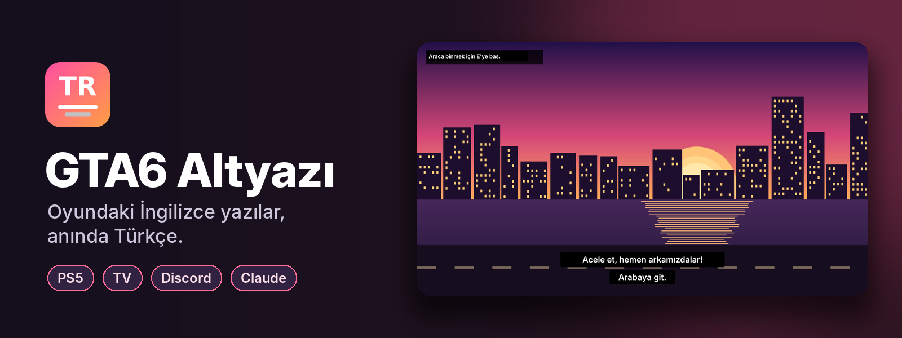
</p>

<p align="center">
  <a href="https://github.com/CH4P4R/gta6-altyazi/releases"></a>
  
  
  
  <a href="LICENSE"></a>
</p>

<p align="center">
  <b>GTA 6'daki İngilizce yazıları canlı okuyup Türkçesini İngilizcenin tam üstüne, daha büyük yazıyla basan Windows uygulaması.</b><br>
  Diyaloglar, sol üstteki yardım kutusu ve sağ üstteki bildirimler kendiliğinden çevrilir; menü, harita ve telefon ekranı tek tuşla.
</p>

<p align="center">
  <a href="#-indir-ve-kur"><b>İndir</b></a> ·
  <a href="#-nasıl-görünüyor">Nasıl görünüyor</a> ·
  <a href="#-nasıl-çalışır">Nasıl çalışır</a> ·
  <a href="#-adım-adım-rehber">Rehber</a> ·
  <a href="CHANGELOG.md">Sürüm notları</a> ·
  <a href="#-sık-sorulanlar">SSS</a>
</p>

---

## 🎬 Nasıl görünüyor

<p align="center">
  
</p>

Altta görev yazısı ("Go to the car.") dururken diyalog onun üstüne çıksa bile ikisi **ayrı ayrı** çevrilir ve her biri kendi yerine oturur. Sol üstteki yardım kutusu da aynı anda çevrilir.

<sub>Sahne bir çizimdir, oyun görüntüsü değildir. Yazıların yeri uygulamanın gerçek okuma koduyla bulundu, Türkçesi uygulamanın kendi çizim koduyla basıldı.</sub>

## ✨ Öne çıkanlar

<table>
<tr>
<td width="50%" valign="top">

**⚡ Gecikme yok denecek kadar az**<br>
Daha önce görülen ya da pakette olan satır anında, yeni satır çoğunlukla yarım saniyenin altında gelir.

**🧠 İki katmanlı çeviri**<br>
Ekran kartındaki yerel model hız garantisi verir; Claude argoyu, küfrü ve esprileri koruyarak doğal Türkçeye çevirir. Önceki diyaloglar bağlam olarak gider, isimler (Jason, Lucia, Vice City) çevrilmez.

**🖥️ Ekranın tamamı tek tuşla**<br>
Ctrl+Shift+9: menü, harita, telefon mesajı, tabela... Claude ekranı görerek okur.

</td>
<td width="50%" valign="top">

**📺 Tek bilgisayar, dört ekran**<br>
TV'de oyunun üstünde, bilgisayarda chiaki'nin üstünde, Discord yayınında ve OBS'de aynı anda.

**📦 Hazır çeviri paketleri**<br>
GTA V, RDR2 ve başka oyunların topluluk paketleri tek tıkla. Pakette olan satır ücretsiz ve anında.

**🛡️ Gerçek oyun sorunlarına karşı**<br>
Görev yazısı ile diyalog ayrılır, OCR hatası yüzünden yanlış çeviri gelmez, yazı titremez.

</td>
</tr>
</table>

## 🧭 Nasıl çalışır

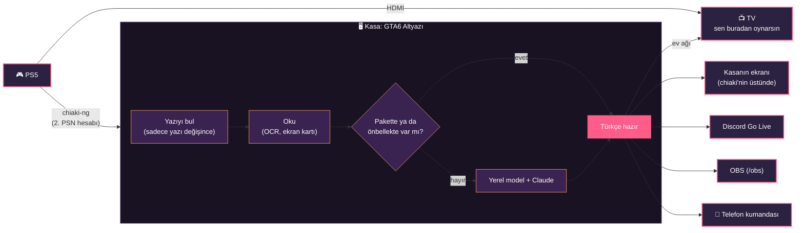

Sen TV'de HDMI'dan, hiç gecikmesiz oynarsın. Kasa aynı görüntüyü chiaki-ng ile ikinci bir PSN hesabından izler, yazıları okur, çevirir ve TV'deki uygulamaya gönderir. TV uygulaması Türkçeyi oyunun üstüne çizer.

### Ne kadar hızlı?

| Durum | Türkçe ne zaman çıkar |
|---|---|
| Daha önce görülmüş ya da pakette olan satır | **~0,05 saniye**, anında gibi |
| İlk kez görülen satır | **en geç ~0,4 saniye**. Claude zamanında gelmezse önce yerel modelin çevirisi çıkar, Claude'unki gelince yerine geçer |
| TV'de ek olarak | **~0,1 saniye**. Kasa görüntüyü chiaki üzerinden biraz geç aldığı için |

Her çevirinin süresi uygulamanın ana ekranında ve oyunun sağ üstünde görünür.

## 🪟 Uygulama

<table>
<tr>
<td width="50%"><br><sub><b>Ana ekran:</b> başlat/durdur, ortalama gecikme, PS5/TV/motor durumu, telefon kumandası QR'ı, canlı çeviriler</sub></td>
<td width="50%"><br><sub><b>Okuma alanları:</b> kutuları oyun görüntüsünün üstünde fareyle ayarla; yazı sayılan pikseller kırmızıyla görünür</sub></td>
</tr>
<tr>
<td width="50%"><br><sub><b>Televizyon:</b> TV'yi ağda bul, tek tıkla kur ve başlat, güvenlik duvarı izni</sub></td>
<td width="50%"><br><sub><b>Çeviri:</b> yerel model + Claude, deneme kutusu, sözlük, hazır paketler</sub></td>
</tr>
<tr>
<td width="50%"><br><sub><b>Rehber:</b> kurulumdan yayına her süreç resimli, adım adım</sub></td>
<td width="50%"><br><sub><b>Geçmiş:</b> oturumdaki bütün çeviriler, aranabilir ve kaydedilebilir</sub></td>
</tr>
</table>

| Sayfa | Ne yapar |
|---|---|
| **Ana ekran** | Büyük başlat/durdur düğmesi, gecikme grafiği, PS5/TV/çeviri motoru durumları, telefon kumandası QR kodu, kopyalanabilir canlı çeviri akışı |
| **Okuma alanları** | Bölgeleri fareyle taşı ve boyutlandır, hazır konumlar, Türkçe yazı boyutu ve İngilizceyi kapatan kutu |
| **Televizyon** | TV'yi ağda bulma, eşleştirme, kurma, mod seçimi, deneme altyazısı, güvenlik duvarı izni |
| **Çeviri** | Yerel model / Google, Claude / Gemini / DeepL, API anahtarı, deneme çevirisi, sözlük, hazır çeviri paketleri |
| **Geçmiş** | Oturumdaki bütün çeviriler; aranabilir, metin olarak kaydedilebilir |
| **Rehber** | Kurulumdan yayına bütün süreçler resimli, adım adım (bu sayfadaki rehberle aynı) |
| **Ayarlar** | Görüntü kaynağı (chiaki / capture kart), gösterim, kısayollar, otomatik başlatma, OBS adresi |

## 📥 İndir ve kur

1. **[Releases](https://github.com/CH4P4R/gta6-altyazi/releases)** sayfasından en son `GTA6Altyazi-Setup.exe`'yi indir.
2. Çalıştır. Yönetici izni istemez. "Windows kişisel bilgisayarınızı korudu" uyarısı çıkarsa **Ek bilgi › Yine de çalıştır**'a bas.
3. İlk açılışta resimli kurulum sihirbazı karşılar: nerede oynayacağın, PS5 ve chiaki-ng, TV, çeviri (Claude anahtarı) ve hazır.

Kurulumun içinde her şey var: yerel çeviri modeli (internetsiz çalışır), OCR, TV uygulamaları ve TV'ye kurmak için gereken araçlar. Ayrıca bir şey indirmen gerekmez.

> [!NOTE]
> Claude anahtarını [console.anthropic.com](https://console.anthropic.com/settings/keys)'dan alırsın. Anahtar sadece senin bilgisayarında saklanır. Anahtar girmezsen uygulama yalnızca yerel modelle çalışır.

## 🗺️ Kurulum yolculuğu

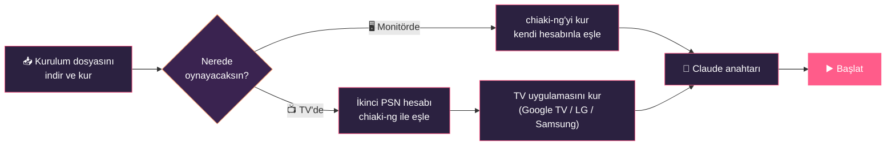

Uygulamayı ilk açtığında **resimli kurulum sihirbazı** bu yolu adım adım yürütür; her adımda neye basacağın resimde işaretlidir. Sonradan bir şeye bakmak istersen uygulamadaki **Rehber** sayfası aynı anlatımı her zaman açık tutar.

<table>
<tr>
<td width="50%"><br><sub><b>Sihirbaz:</b> nerede oynayacağını seç, anlatım ona göre değişsin</sub></td>
<td width="50%"><br><sub><b>Sihirbaz:</b> her adım resimli; neye basacağın işaretli</sub></td>
</tr>
</table>

## 📖 Adım adım rehber

<!-- REHBER:BASLA -->

> Bu bölüm uygulamadaki **Rehber** sayfasıyla aynıdır (kaynak: `altyazi/rehber.py`). Uygulamada da soldaki menüden **Rehber**'e girip aynı adımları resimli izleyebilirsin.

| Konu | Ne anlatıyor |
|---|---|
| 🖥️ [Bilgisayar monitöründe oyna](#rehber-monitor) | chiaki-ng ile PS5'i bilgisayarda oyna; Türkçe chiaki'nin üstünde çıksın. |
| 📺 [TV'de oyna, bilgisayar izlesin](#rehber-tv-izle) | Sen TV'den HDMI ile oyna; bilgisayar ikinci hesapla izleyip Türkçeyi TV'ye göndersin. |
| 🤖 [TV uygulaması: Google TV / Android TV](#rehber-google-tv) | TCL, Sony, Philips, Xiaomi, Hisense ve diğer Android TV'ler. |
| 📺 [TV uygulaması: LG (webOS)](#rehber-lg) | LG Developer Mode ile kurulum. |
| 📺 [TV uygulaması: Samsung (Tizen)](#rehber-samsung) | Tizen Studio olmadan, Samsung hesabıyla kurulum. |
| 💬 [Discord'da arkadaşlarına yayın](#rehber-discord) | Arkadaşların Türkçe altyazılı izlesin. |
| 🎥 [OBS ile yayın](#rehber-obs) | Türkçe altyazıyı OBS'de oyunun üstüne koy. |
| 🎯 [GTA 6 için okuma alanlarını ayarla](#rehber-gta6) | Kutuları gerçek altyazının üstüne oturt (5 dakika). |
| 📦 [Hazır çeviri paketleri](#rehber-paketler) | GTA V, RDR2 ve diğer oyunların paketleri; kendi paketini paylaş. |
| 🧰 [Sorun giderme](#rehber-sorunlar) | TV bağlanmıyor, altyazı çıkmıyor, yazı kayık... |

<a name="rehber-monitor"></a>
<details>
<summary><b>🖥️ Bilgisayar monitöründe oyna</b> · chiaki-ng ile PS5'i bilgisayarda oyna; Türkçe chiaki'nin üstünde çıksın.</summary>

#### Adım 1: chiaki-ng'yi indir ve kur


1. **İndirme sayfasını aç**'a bas.
2. En üstteki sürümün **Assets** listesinde adında **windows** geçen dosyayı indir.
3. İndirdiğin dosyayı çalıştırıp kur.

🔗 [İndirme sayfasını aç](https://github.com/streetpea/chiaki-ng/releases)

> chiaki-ng, PS5'in görüntüsünü ağ üzerinden bilgisayara getiren ücretsiz programdır.

#### Adım 2: chiaki-ng'de PSN girişi

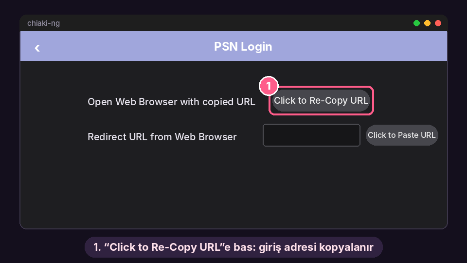

1. chiaki-ng'yi aç. PS5 eklemek için hesabını ister: **PSN Login** ekranı açılır.
2. **Click to Re-Copy URL**'ye bas. Sony'nin giriş adresi kopyalanır.

#### Adım 3: Tarayıcıda giriş yap


1. Chrome ya da Edge'i aç, adres çubuğuna tıkla, **Ctrl+V** yap ve **Enter**'a bas.
2. Açılan PlayStation sayfasında **Kendi PlayStation hesabınla** giriş yap (oyunların ve kayıtların o hesapta).

#### Adım 4: Açılan sayfanın adresini kopyala


1. Giriş bitince boş ya da hatalı görünen bir sayfa açılır. **Bu normal.**
2. Adres çubuğuna tıkla (adres *remoteplay.dl.playstation.net/…redirect?code=* ile başlar).
3. **Ctrl+A**, sonra **Ctrl+C** yap.

> Bu kod birkaç dakika geçerli, hızlı ol.

#### Adım 5: chiaki-ng'ye yapıştır

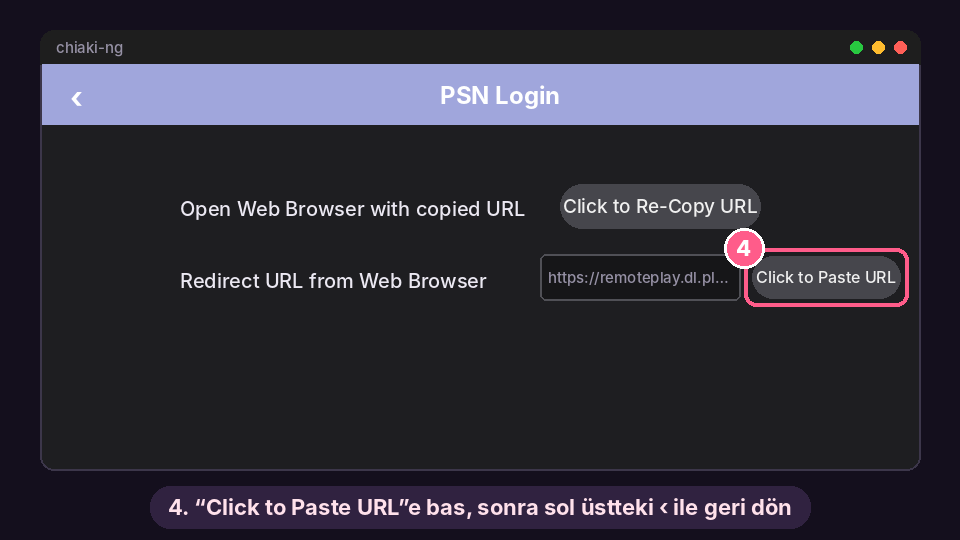

1. chiaki-ng'ye dön, **Click to Paste URL**'ye bas.
2. Hesap bilgisi alınır; sol üstteki **‹** ile ana ekrana dön.

> Hata verirse kodun süresi dolmuştur: PSN girişi adımından tekrarla.

#### Adım 6: PS5'te bağlantı kodunu al

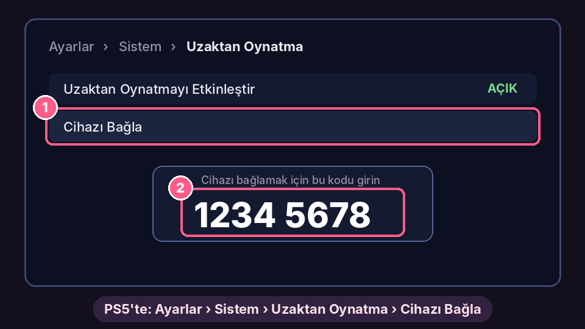

1. PS5'te chiaki'ye girdiğin hesapla oturum açıkken **Ayarlar › Sistem › Uzaktan Oynatma**: **Uzaktan Oynatmayı Etkinleştir** açık olsun.
2. **Cihazı Bağla**'ya bas; 8 haneli bir kod çıkar (ekranda bırak).
3. **Ayarlar › Sistem › Güç Tasarrufu › Dinlenme Modunda Kullanılabilir Özellikler**: **İnternete Bağlı Kal** ve **Ağ Üzerinden PS5'i Açmayı Etkinleştir**'i aç.

> TV'de oynayacaksan Uzaktan Oynatma ayarlarındaki bağlantı durumu açılır penceresini gizle; yoksa chiaki bağlanınca TV ekranında "bağlandı" yazısı çıkar.

#### Adım 7: PS5'i chiaki-ng'ye kaydet

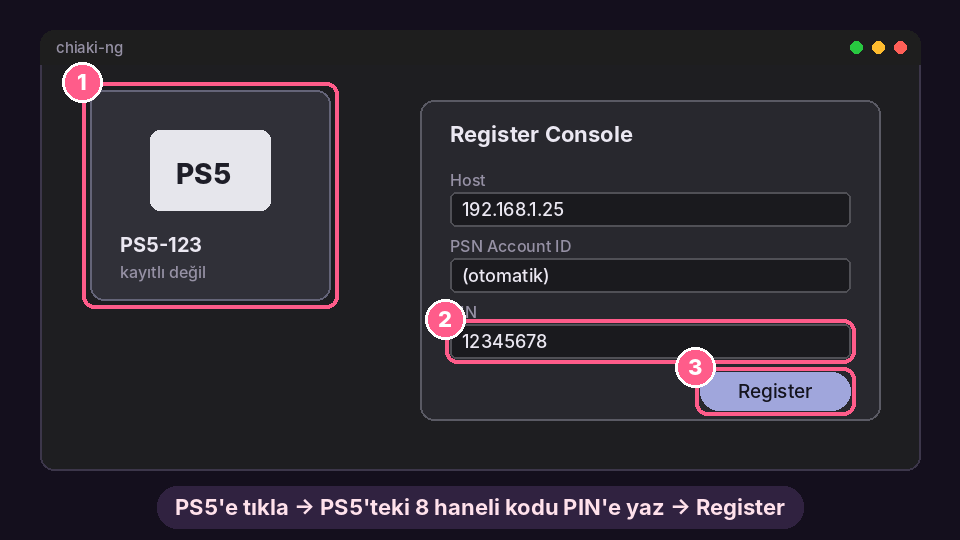

1. chiaki-ng ana ekranında PS5'in kutusuna tıkla.
2. **PIN** kutusuna PS5'teki 8 haneli kodu yaz.
3. **Register**'a bas.

> PS5 görünmüyorsa PS5 ve bilgisayar aynı modeme bağlı mı bak; sağ üstteki + ile IP'siyle de eklenir.

#### Adım 8: Görüntü ayarları (bir kere)


1. chiaki-ng ayarlarında (dişli simgesi) **Video** bölümüne gir.
2. **Resolution: 1080p**, **FPS: 60** seç.
3. **Bitrate**'i en yükseğe al.

> Yazıların net okunması için bu önemli.

#### Adım 9: Kolu bilgisayara bağla


1. DualSense'i **USB kablosuyla** bilgisayara tak (titreşim de çalışır). Bluetooth da olur.

#### Adım 10: Bağlan

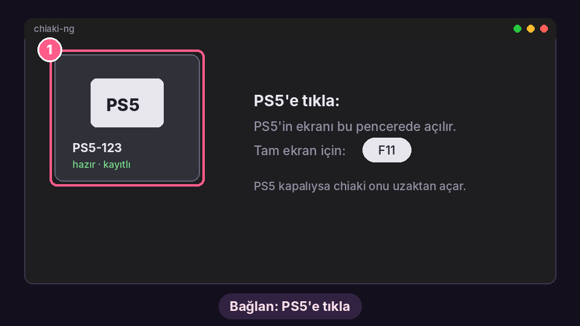

1. chiaki-ng'de PS5'in kutusuna tıkla; PS5'in ekranı açılır, kolla oynarsın.
2. İstersen **F11** ile tam ekran yap.

#### Adım 11: Türkçeyi aç


1. **GTA6 Altyazı**'yı aç.
2. Ana ekrandaki büyük düğmeye (**Başlat**) bas.
3. Oyunda İngilizce altyazıyı aç; yazılar Türkçe görünür.

> Kısayollar: Ctrl+Shift+9 ekranın tamamını çevirir, Ctrl+Shift+0 duraklatır.

</details>

<a name="rehber-tv-izle"></a>
<details>
<summary><b>📺 TV'de oyna, bilgisayar izlesin</b> · Sen TV'den HDMI ile oyna; bilgisayar ikinci hesapla izleyip Türkçeyi TV'ye göndersin.</summary>

#### Adım 1: İkinci PSN hesabı aç (ücretsiz)

1. Ücretsiz yeni bir PlayStation hesabı aç.
2. PS5'i aç ve bu yeni hesapla **bir kez** oturum aç.

🔗 [PSN hesabı aç](https://www.playstation.com/tr-tr/playstation-network/)

> TV'de oynarken bilgisayar PS5'i ikinci bir hesapla izler; kendi hesabınla bağlanırsa TV'deki kolun kopar.

#### Adım 2: chiaki-ng'yi indir ve kur


1. **İndirme sayfasını aç**'a bas.
2. En üstteki sürümün **Assets** listesinde adında **windows** geçen dosyayı indir.
3. İndirdiğin dosyayı çalıştırıp kur.

🔗 [İndirme sayfasını aç](https://github.com/streetpea/chiaki-ng/releases)

> chiaki-ng, PS5'in görüntüsünü ağ üzerinden bilgisayara getiren ücretsiz programdır.

#### Adım 3: chiaki-ng'de PSN girişi


1. chiaki-ng'yi aç. PS5 eklemek için hesabını ister: **PSN Login** ekranı açılır.
2. **Click to Re-Copy URL**'ye bas. Sony'nin giriş adresi kopyalanır.

#### Adım 4: Tarayıcıda giriş yap


1. Chrome ya da Edge'i aç, adres çubuğuna tıkla, **Ctrl+V** yap ve **Enter**'a bas.
2. Açılan PlayStation sayfasında **İkinci PSN hesabınla** giriş yap. Kendi hesabınla girersen TV'de oynarken kolun kopar.

#### Adım 5: Açılan sayfanın adresini kopyala


1. Giriş bitince boş ya da hatalı görünen bir sayfa açılır. **Bu normal.**
2. Adres çubuğuna tıkla (adres *remoteplay.dl.playstation.net/…redirect?code=* ile başlar).
3. **Ctrl+A**, sonra **Ctrl+C** yap.

> Bu kod birkaç dakika geçerli, hızlı ol.

#### Adım 6: chiaki-ng'ye yapıştır


1. chiaki-ng'ye dön, **Click to Paste URL**'ye bas.
2. Hesap bilgisi alınır; sol üstteki **‹** ile ana ekrana dön.

> Hata verirse kodun süresi dolmuştur: PSN girişi adımından tekrarla.

#### Adım 7: PS5'te bağlantı kodunu al


1. PS5'te chiaki'ye girdiğin hesapla oturum açıkken **Ayarlar › Sistem › Uzaktan Oynatma**: **Uzaktan Oynatmayı Etkinleştir** açık olsun.
2. **Cihazı Bağla**'ya bas; 8 haneli bir kod çıkar (ekranda bırak).
3. **Ayarlar › Sistem › Güç Tasarrufu › Dinlenme Modunda Kullanılabilir Özellikler**: **İnternete Bağlı Kal** ve **Ağ Üzerinden PS5'i Açmayı Etkinleştir**'i aç.

> TV'de oynayacaksan Uzaktan Oynatma ayarlarındaki bağlantı durumu açılır penceresini gizle; yoksa chiaki bağlanınca TV ekranında "bağlandı" yazısı çıkar.

#### Adım 8: PS5'i chiaki-ng'ye kaydet


1. chiaki-ng ana ekranında PS5'in kutusuna tıkla.
2. **PIN** kutusuna PS5'teki 8 haneli kodu yaz.
3. **Register**'a bas.

> PS5 görünmüyorsa PS5 ve bilgisayar aynı modeme bağlı mı bak; sağ üstteki + ile IP'siyle de eklenir.

#### Adım 9: Görüntü ayarları (bir kere)


1. chiaki-ng ayarlarında (dişli simgesi) **Video** bölümüne gir.
2. **Resolution: 1080p**, **FPS: 60** seç.
3. **Bitrate**'i en yükseğe al.

> Yazıların net okunması için bu önemli.

#### Adım 10: Bağlan


1. chiaki-ng'de PS5'in kutusuna tıkla. Sen TV'den oynamaya devam et; chiaki açık kalsın.
2. chiaki penceresini **simge durumuna küçültme**, program görüntüyü oradan okuyor.

#### Adım 11: Türkçeyi aç


1. **GTA6 Altyazı**'yı aç.
2. Ana ekrandaki büyük düğmeye (**Başlat**) bas.
3. Oyunda İngilizce altyazıyı aç; yazılar Türkçe görünür.

> Kısayollar: Ctrl+Shift+9 ekranın tamamını çevirir, Ctrl+Shift+0 duraklatır.

</details>

<a name="rehber-google-tv"></a>
<details>
<summary><b>🤖 TV uygulaması: Google TV / Android TV</b> · TCL, Sony, Philips, Xiaomi, Hisense ve diğer Android TV'ler.</summary>

#### Adım 1: TV'de geliştirici seçeneklerini aç


1. TV kumandasıyla **Ayarlar › Sistem › Hakkında**'ya gir.
2. **Android TV OS derlemesi** satırına arka arkaya **7 kez** bas. "Artık geliştiricisiniz" yazar.

#### Adım 2: USB hata ayıklamayı aç


1. **Ayarlar › Sistem › Geliştirici seçenekleri**'ne gir.
2. **USB hata ayıklama**'yı aç.

> Yoksa ya da TV bulunamazsa Kablosuz hata ayıklama'yı aç; ekrandaki eşleştirme adresi ve kodunu programdaki Eşleştir kısmına yazarsın.

#### Adım 3: Bağlan ve izin ver

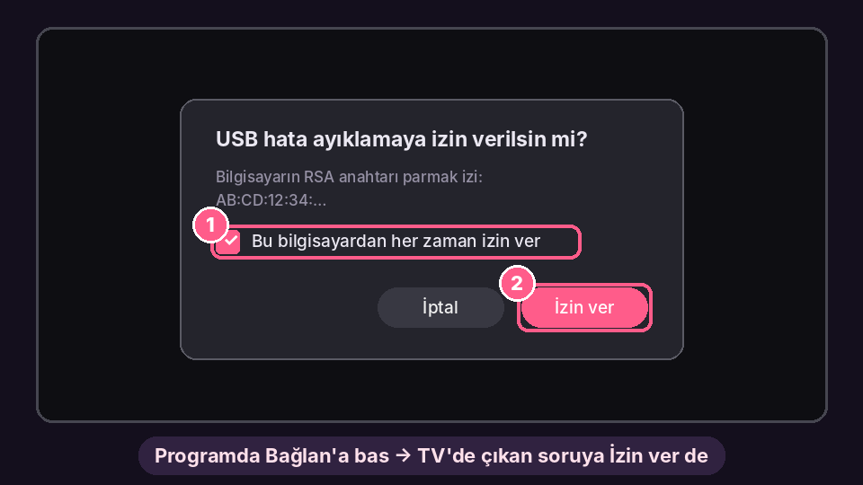

1. Programda **Televizyon** sayfasında **Ağda ara**'ya bas (ya da TV'nin IP'sini yaz), sonra **Bağlan, kur ve başlat**'a bas.
2. TV'de çıkan soruda **Bu bilgisayardan her zaman izin ver**'i işaretle, **İzin ver**'e bas.

> TV uygulaması PS5'in HDMI'ını kendisi bulur. TV HDMI'yı öne alırsa ya da görüntü siyah kalırsa kendiliğinden katman moduna geçer.

</details>

<a name="rehber-lg"></a>
<details>
<summary><b>📺 TV uygulaması: LG (webOS)</b> · LG Developer Mode ile kurulum.</summary>

#### Adım 1: TV'de Developer Mode'u aç


1. TV'de **LG Content Store**'dan ücretsiz **Developer Mode** uygulamasını kur ve LG hesabınla gir.
2. **Dev Mode Status**'u aç; TV yeniden başlar.
3. Uygulamayı tekrar aç ve **Key Server**'ı aç.

#### Adım 2: Programdan kur


1. Programda **Televizyon** sayfasında markayı **LG** seç.
2. Developer Mode ekranındaki **IP** adresini ve **Passphrase**'i yaz.
3. **Bağlan, kur ve başlat**'a bas.

> Geliştirici modu en çok 1000 saat açık kalır; program her bağlanışta süreyi kendisi baştan başlatır.

</details>

<a name="rehber-samsung"></a>
<details>
<summary><b>📺 TV uygulaması: Samsung (Tizen)</b> · Tizen Studio olmadan, Samsung hesabıyla kurulum.</summary>

#### Adım 1: TV'de Developer mode'u aç


1. TV'de **Uygulamalar** ekranını aç.
2. Kumandayla **1 2 3 4 5** yaz; Developer mode penceresi açılır.
3. **Developer mode**'u **On** yap, **Host PC IP**'ye bu bilgisayarın IP'sini yaz (program Televizyon sayfasında gösterir), **OK**'a bas.
4. TV'yi güç tuşuna yaklaşık 2 saniye basılı tutarak yeniden başlat.

> Tizen Studio gerekmez.

#### Adım 2: Programdan kur


1. Programda **Televizyon** sayfasında markayı **Samsung** seç ve **Bağlan, kur ve başlat**'a bas.
2. İlk seferde tarayıcıda bir kez **Samsung hesabınla** giriş yap; program uygulamayı TV'ne özel imzalatır, kurar ve açar.

> TV kendiliğinden HDMI'ya geçiyorsa Anynet+ (HDMI-CEC) ve Otomatik Kaynak Değiştirme'yi kapat.

</details>

<a name="rehber-discord"></a>
<details>
<summary><b>💬 Discord'da arkadaşlarına yayın</b> · Arkadaşların Türkçe altyazılı izlesin.</summary>

#### Adım 1: Bilgisayardan yayın aç

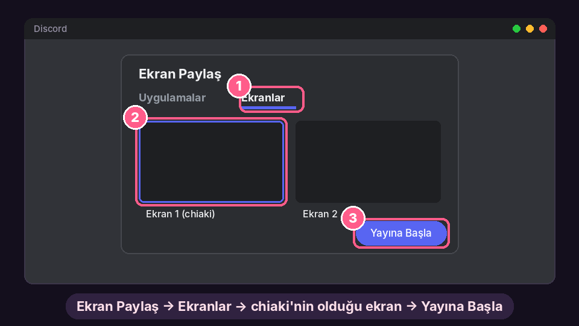

1. Bilgisayarda ikinci bir Discord hesabıyla sesli kanala gir; mikrofonunu ve sesini kapat.
2. **Ekran Paylaş**'a bas, **Ekranlar** sekmesinden chiaki'nin olduğu monitörü seç, **Yayına Başla**'ya bas.

> Tüm ekranı paylaşmak şart: Türkçe yazı ayrı bir katman olduğu için sadece chiaki penceresini paylaşırsan görünmez.

#### Adım 2: Başka cihazdan konuş


1. Telefondan ya da başka bir bilgisayardan kendi hesabınla aynı kanala gir ve konuş.
2. Kulaklık kullan; yoksa mikrofon TV'nin sesini de alır.

> Bilgisayarın ekranı kilitlenirse okuma durur: ekranı hiç kapanmayacak şekilde ayarla.

</details>

<a name="rehber-obs"></a>
<details>
<summary><b>🎥 OBS ile yayın</b> · Türkçe altyazıyı OBS'de oyunun üstüne koy.</summary>

#### Adım 1: OBS'ye tarayıcı kaynağı ekle


1. OBS'de **Kaynaklar** kutusunda **+**'ya bas, **Tarayıcı**'yı seç.
2. URL: **http://localhost:8787/obs**, genişlik **1920**, yükseklik **1080** yaz.
3. Bu kaynağı oyun görüntüsünün **üstüne** koy.

> Capture kart kullanıyorsan OBS'de Sanal Kamerayı Başlat'a bas ve programda kaynak olarak OBS Virtual Camera'yı seç.

</details>

<a name="rehber-gta6"></a>
<details>
<summary><b>🎯 GTA 6 için okuma alanlarını ayarla</b> · Kutuları gerçek altyazının üstüne oturt (5 dakika).</summary>

#### Adım 1: Oyundan bir kare al

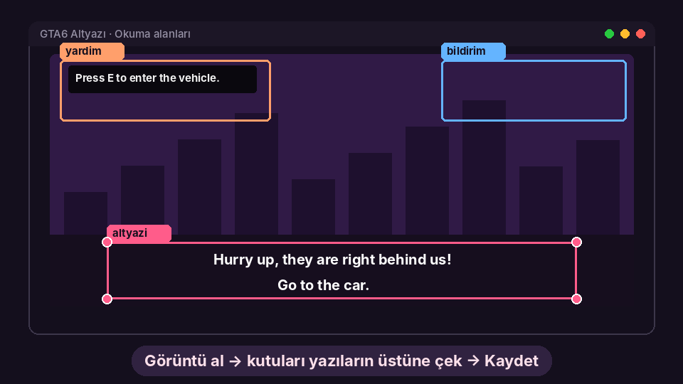

1. Oyunda bir altyazı ekrandayken programda **Okuma alanları** sayfasına gir.
2. **Görüntü al**'a bas.

#### Adım 2: Kutuları yazıların üstüne çek


1. **altyazi** kutusunu alttaki diyalog ve görev yazısının üstüne, **yardim**'ı sol üstteki yardım kutusuna, **bildirim**'i sağ üstteki bildirimlere oturt.
2. **Algılanan yazıyı kırmızı göster** açıkken kırmızı noktalar yazının üstünde toplanıyorsa ayar doğrudur.
3. **Kaydet**'e bas.

</details>

<a name="rehber-paketler"></a>
<details>
<summary><b>📦 Hazır çeviri paketleri</b> · GTA V, RDR2 ve diğer oyunların paketleri; kendi paketini paylaş.</summary>

#### Adım 1: Hazır paket indir

1. **Çeviri** sayfasında **Önbellek ve çeviri paketleri** kartına in.
2. Listeden oyunu seç (GTA V, RDR2...) ve **Hazır paketi indir**'e bas.

> Pakette olan satırlar anında ve ücretsiz gelir, yapay zekâya sorulmaz.

#### Adım 2: Kendi paketini paylaş

1. **Önbelleği paket olarak kaydet** ile oynadıkça biriken çevirileri dosya yap.
2. Arkadaşların bu dosyayı **Paket ekle** ile yükler.

</details>

<a name="rehber-sorunlar"></a>
<details>
<summary><b>🧰 Sorun giderme</b> · TV bağlanmıyor, altyazı çıkmıyor, yazı kayık...</summary>

#### Adım 1: TV bilgisayara bağlanamıyor

1. **Televizyon** sayfasında **Bağlantı izni › İzin ver**'e bas (Windows bir kez "Evet" ister).
2. Bilgisayarın ağı **Ortak** görünüyorsa Windows Ayarları › Ağ ve İnternet'te **Özel** yap.
3. TV ve bilgisayar aynı modeme mi bağlı, bak; menzil arttırıcı bazen cihazları ayırır.

#### Adım 2: Altyazı hiç çıkmıyor

1. Oyunun kendi ayarlarında **altyazılar açık** mı, bak.
2. chiaki penceresi **simge durumunda** olmasın.
3. **Okuma alanları › Görüntü al** ile kutuların yazının üstünde olduğunu kontrol et.

#### Adım 3: Türkçe kayık ya da yanlış yerde

1. chiaki'yi tam ekran (**F11**) yap ya da pencereyi büyüt.
2. **Okuma alanları**'nda kutuları yeniden oturt.
3. TV'de kumandanın **Yeşil** tuşu bilgi panelini açar; bağlantı ve HDMI orada görünür.

#### Adım 4: chiaki PS5'e bağlanmıyor

1. PS5'te **Uzaktan Oynatma** açık mı, bak.
2. Kayıt sırasında PIN hatası verdiyse kodun süresi dolmuştur; PS5'te **Cihazı Bağla**'ya yeniden bas.
3. chiaki'ye girdiğin hesapla PS5'te oturum açtığından emin ol.

#### Adım 5: Çeviri yavaş ya da Claude çalışmıyor

1. **Çeviri** sayfasındaki **Dene** kutusuna bir cümle yazıp **Çevir**'e bas; süreyi ve motoru gösterir.
2. Claude anahtarını ve Anthropic hesabındaki krediyi kontrol et.
3. Anahtar yoksa da program yerel modelle çalışmaya devam eder.

</details>

<!-- REHBER:BITIS -->

### Desteklenen TV'ler

| TV | Nasıl çalışır | TV'de yapılacak |
|---|---|---|
| **Google TV / Android TV** | Oyunun üstüne katman ya da HDMI uygulamanın içinde | Geliştirici seçenekleri › USB / Kablosuz hata ayıklama |
| **LG (webOS)** | HDMI uygulamanın içinde, altyazı üstünde | Developer Mode uygulaması |
| **Samsung (Tizen)** | HDMI uygulamanın içinde, altyazı üstünde | Developer mode (1-2-3-4-5) |

TV kumandası: **Yeşil** bilgi paneli · **◀ ▶** ya da **1-4** HDMI girişi · **0** konsolu yeniden ara · **Kırmızı** deneme altyazısı.

## ⌨️ Kısayollar

| Tuş | Ne yapar |
|---|---|
| **Ctrl+Shift+9** | Ekrandaki her şeyi çevirir (menü, harita, telefon...). Tekrar basınca ya da 20 saniye sonra kapanır |
| **Ctrl+Shift+0** | Duraklatır / devam ettirir |

TV'den oynarken aynı düğmeler telefon kumandasında da var; ana ekrandaki QR kodunu okutman yeterli.


## ❓ Sık sorulanlar

<details>
<summary><b>Capture kart almam gerekiyor mu?</b></summary>

Hayır. Kasa görüntüyü chiaki-ng ile ağ üzerinden alır. Capture kart istersen de destekleniyor (Ayarlar › Görüntü kaynağı).

</details>

<details>
<summary><b>İnternet olmadan çalışır mı?</b></summary>

Evet. Yerel model, OCR ve paketler internetsiz çalışır. Claude ve "ekranı çevir" özelliği internet ister.

</details>

<details>
<summary><b>Claude'un maliyeti ne olur?</b></summary>

Claude'a yalnızca daha önce görülmemiş satırlar gider; önbellekte ya da pakette olan satırlar ücretsizdir. Oynadıkça önbellek büyür ve maliyet düşer. Kullanım Anthropic hesabından ücretlendirilir.

</details>

<details>
<summary><b>Görev yazısı ile diyalog üst üste binince ne olur?</b></summary>

Satırlar arasındaki boşluğa bakılarak ikisi ayrı yazı sayılır, ayrı çevrilir ve her biri kendi yerine basılır. İki satıra bölünmüş tek bir cümle ise ayrılmaz.

</details>

<details>
<summary><b>OCR bir harfi yanlış okursa?</b></summary>

Daha önce çevrilmiş satır önbellekten yine bulunur; yalnızca OCR'ın gerçekten karıştırdığı harf farklarına (l/1/I, 0/O gibi) izin verilir. "Go to the car" ile "Go to the bar" ya da "$500" ile "$5000" gibi anlamı farklı cümleler asla karıştırılmaz.

</details>

<details>
<summary><b>Bu proje Rockstar ya da Sony ile bağlantılı mı?</b></summary>

Hayır. Bağımsız, ücretsiz ve açık kaynaklı bir hayran projesidir.

</details>

## 🛠️ Geliştirme

<details>
<summary>Kaynak koddan çalıştırma, klasörler, derleme</summary>

```bash
pip install -r requirements.txt pytest pillow
python -m altyazi              # arayüz
python -m altyazi calistir     # arayüzsüz
python -m pytest tests
```

| Klasör | İçerik |
|---|---|
| `altyazi/` | Çekirdek: yakalama, tespit, OCR, çeviri, hat, sunucu, TV kurulumu |
| `altyazi/ui/` | Arayüz (PySide6) |
| `altyazi/samsung/` | Tizen Studio'suz Samsung kurulumu |
| `tv-android/` | Android TV uygulaması |
| `tv-web/` | LG (webOS) ve Samsung (Tizen) TV uygulaması |
| `packaging/` | PyInstaller tarifi, Inno Setup kurulum betiği, görseller |
| `tests/` | Testler. `synth.py` GTA tarzı sahte kareler üretir |
| `tools/` | Model indirme, TV paketi hazırlama, README görselleri (`readme_gorsel.py`) |

- **Kurulum dosyasını kendin derlemek:** `derle.bat`'a çift tıkla (Python 3.12 ve Inno Setup gerekir). Sonuç: `dist\GTA6Altyazi-Setup.exe`.
- **Otomatik derleme:** TV uygulamaları `tv-android/` ya da `tv-web/` değişince GitHub Actions ile derlenir. Windows kurulum dosyası commit mesajında `[exe]` geçince derlenip Releases'e konur.
- **README görselleri:** `QT_QPA_PLATFORM=offscreen python tools/readme_gorsel.py`

</details>

## 📜 Lisans ve teşekkür

GTA6 Altyazı, [GNU AGPL-3.0](LICENSE) ile lisanslanmıştır. Sinan Yorulmaz'ın [CouchSubs](https://github.com/yorulmazsinan/couchsubs) projesinden (ve ondan türeyen [GameTranslator](https://gitlab.com/sefflex/GameTranslator)'dan) alınan kodları içerir; ayrıntılar [NOTICE](NOTICE) dosyasında. TV uygulamaları CouchSubs'tan gelir. CouchSubs ve GameTranslator geliştiricilerine teşekkürler.

<sub>GTA6 Altyazı; Rockstar Games, Take-Two Interactive ya da Sony Interactive Entertainment ile bağlantılı değildir. "Grand Theft Auto" Take-Two'nun, "PlayStation" ve "PS5" Sony Interactive Entertainment Inc.'in ticari markalarıdır.</sub>
