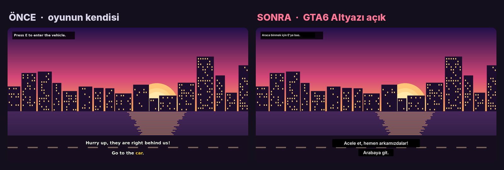
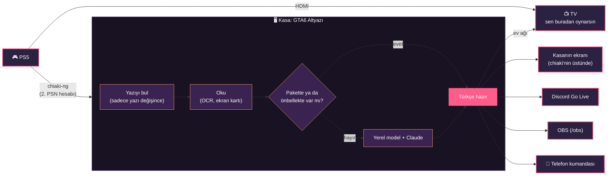
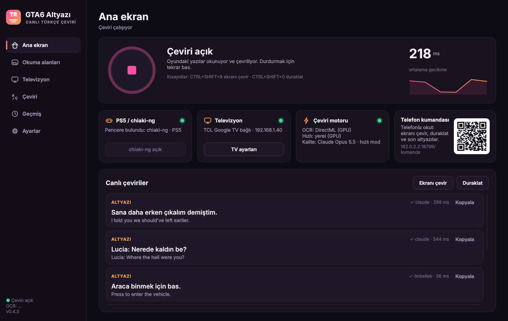
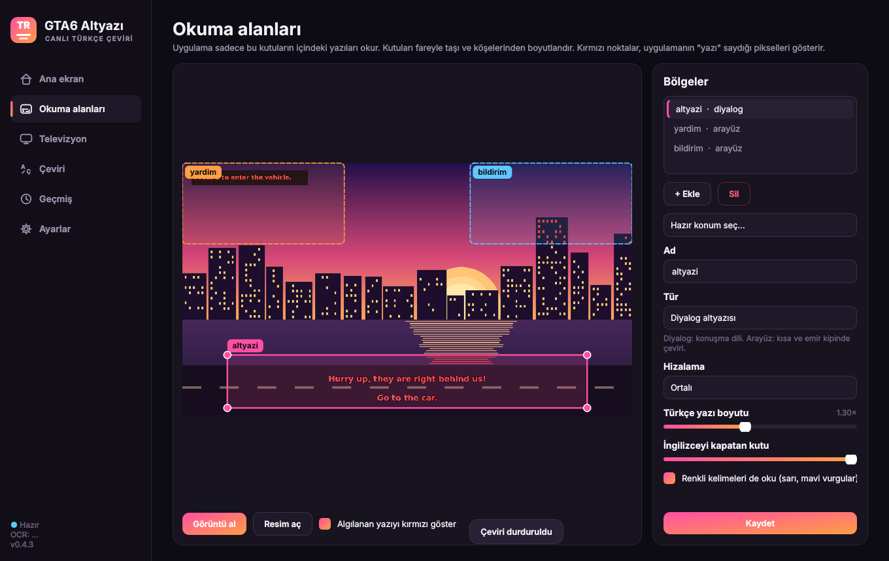
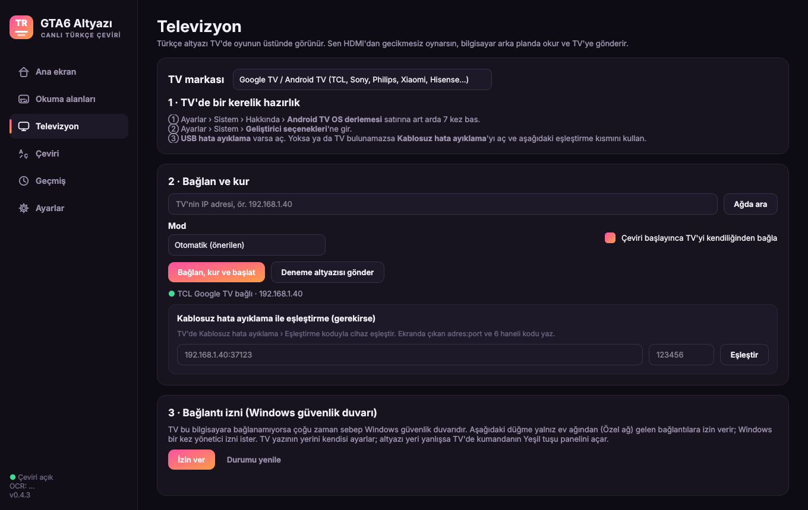
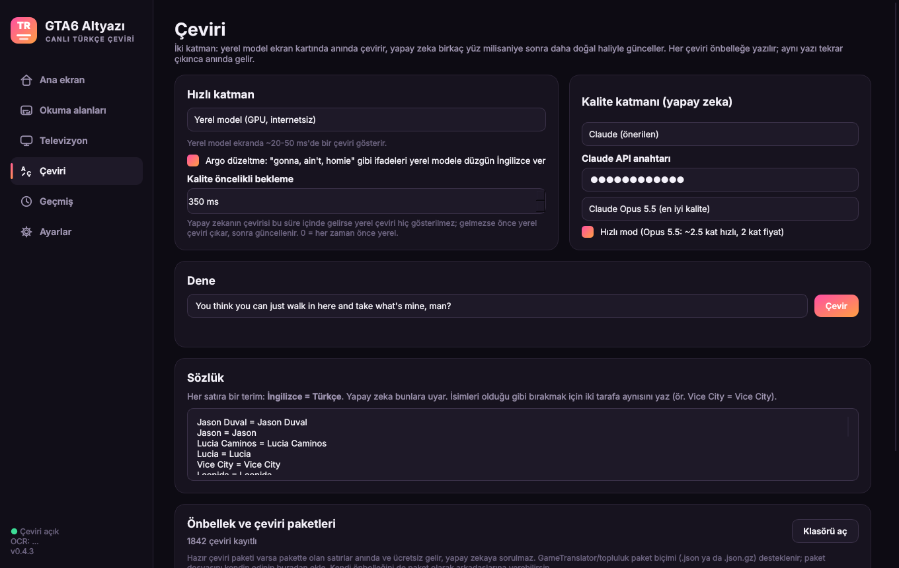

<p align="center">
  
</p>

<p align="center">
  <a href="https://github.com/CH4P4R/gta6-altyazi/releases"></a>
  
  
  
  <a href="LICENSE"></a>
</p>

<p align="center">
  <b>GTA 6'daki İngilizce yazıları canlı okuyup Türkçesini İngilizcenin tam üstüne, daha büyük yazıyla basan Windows uygulaması.</b><br>
  Diyaloglar, sol üstteki yardım kutusu ve sağ üstteki bildirimler kendiliğinden çevrilir; menü, harita ve telefon ekranı tek tuşla.
</p>

<p align="center">
  <a href="#-indir-ve-kur"><b>İndir</b></a> ·
  <a href="#-nasıl-görünüyor">Nasıl görünüyor</a> ·
  <a href="#-nasıl-çalışır">Nasıl çalışır</a> ·
  <a href="#-evdeki-kurulum">Kurulum rehberi</a> ·
  <a href="#-sık-sorulanlar">SSS</a>
</p>

---

## 🎬 Nasıl görünüyor

<p align="center">
  
</p>

Altta görev yazısı ("Go to the car.") dururken diyalog onun üstüne çıksa bile ikisi **ayrı ayrı** çevrilir ve her biri kendi yerine oturur. Sol üstteki yardım kutusu da aynı anda çevrilir.

<sub>Sahne bir çizimdir, oyun görüntüsü değildir. Yazıların yeri uygulamanın gerçek okuma koduyla bulundu, Türkçesi uygulamanın kendi çizim koduyla basıldı.</sub>

## ✨ Öne çıkanlar

<table>
<tr>
<td width="50%" valign="top">

**⚡ Gecikme yok denecek kadar az**<br>
Daha önce görülen ya da pakette olan satır anında, yeni satır çoğunlukla yarım saniyenin altında gelir.

**🧠 İki katmanlı çeviri**<br>
Ekran kartındaki yerel model hız garantisi verir; Claude argoyu, küfrü ve esprileri koruyarak doğal Türkçeye çevirir. Önceki diyaloglar bağlam olarak gider, isimler (Jason, Lucia, Vice City) çevrilmez.

**🖥️ Ekranın tamamı tek tuşla**<br>
Ctrl+Shift+9: menü, harita, telefon mesajı, tabela... Claude ekranı görerek okur.

</td>
<td width="50%" valign="top">

**📺 Tek bilgisayar, dört ekran**<br>
TV'de oyunun üstünde, bilgisayarda chiaki'nin üstünde, Discord yayınında ve OBS'de aynı anda.

**📦 Hazır çeviri paketleri**<br>
GTA V, RDR2 ve başka oyunların topluluk paketleri tek tıkla. Pakette olan satır ücretsiz ve anında.

**🛡️ Gerçek oyun sorunlarına karşı**<br>
Görev yazısı ile diyalog ayrılır, OCR hatası yüzünden yanlış çeviri gelmez, yazı titremez.

</td>
</tr>
</table>

## 🧭 Nasıl çalışır



Sen TV'de HDMI'dan, hiç gecikmesiz oynarsın. Kasa aynı görüntüyü chiaki-ng ile ikinci bir PSN hesabından izler, yazıları okur, çevirir ve TV'deki uygulamaya gönderir. TV uygulaması Türkçeyi oyunun üstüne çizer.

### Ne kadar hızlı?

| Durum | Türkçe ne zaman çıkar |
|---|---|
| Daha önce görülmüş ya da pakette olan satır | **~0,05 saniye**, anında gibi |
| İlk kez görülen satır | **en geç ~0,4 saniye**. Claude zamanında gelmezse önce yerel modelin çevirisi çıkar, Claude'unki gelince yerine geçer |
| TV'de ek olarak | **~0,1 saniye**. Kasa görüntüyü chiaki üzerinden biraz geç aldığı için |

Her çevirinin süresi uygulamanın ana ekranında ve oyunun sağ üstünde görünür.

## 🪟 Uygulama

<table>
<tr>
<td width="50%"><br><sub><b>Ana ekran:</b> başlat/durdur, ortalama gecikme, PS5/TV/motor durumu, telefon kumandası QR'ı, canlı çeviriler</sub></td>
<td width="50%"><br><sub><b>Okuma alanları:</b> kutuları oyun görüntüsünün üstünde fareyle ayarla; yazı sayılan pikseller kırmızıyla görünür</sub></td>
</tr>
<tr>
<td width="50%"><br><sub><b>Televizyon:</b> TV'yi ağda bul, tek tıkla kur ve başlat, güvenlik duvarı izni</sub></td>
<td width="50%"><br><sub><b>Çeviri:</b> yerel model + Claude, deneme kutusu, sözlük, hazır paketler</sub></td>
</tr>
</table>

| Sayfa | Ne yapar |
|---|---|
| **Ana ekran** | Büyük başlat/durdur düğmesi, gecikme grafiği, PS5/TV/çeviri motoru durumları, telefon kumandası QR kodu, kopyalanabilir canlı çeviri akışı |
| **Okuma alanları** | Bölgeleri fareyle taşı ve boyutlandır, hazır konumlar, Türkçe yazı boyutu ve İngilizceyi kapatan kutu |
| **Televizyon** | TV'yi ağda bulma, eşleştirme, kurma, mod seçimi, deneme altyazısı, güvenlik duvarı izni |
| **Çeviri** | Yerel model / Google, Claude / Gemini / DeepL, API anahtarı, deneme çevirisi, sözlük, hazır çeviri paketleri |
| **Geçmiş** | Oturumdaki bütün çeviriler; aranabilir, metin olarak kaydedilebilir |
| **Ayarlar** | Görüntü kaynağı (chiaki / capture kart), gösterim, kısayollar, otomatik başlatma, OBS adresi |

## 📥 İndir ve kur

1. **[Releases](https://github.com/CH4P4R/gta6-altyazi/releases)** sayfasından en son `GTA6Altyazi-Setup.exe`'yi indir.
2. Çalıştır. Yönetici izni istemez. "Windows kişisel bilgisayarınızı korudu" uyarısı çıkarsa **Ek bilgi › Yine de çalıştır**'a bas.
3. İlk açılışta 5 adımlı sihirbaz karşılar: PS5 bağlantısı, TV, çeviri (Claude anahtarı) ve hazır.

Kurulumun içinde her şey var: yerel çeviri modeli (internetsiz çalışır), OCR, TV uygulamaları ve TV'ye kurmak için gereken araçlar. Ayrıca bir şey indirmen gerekmez.

> [!NOTE]
> Claude anahtarını [console.anthropic.com](https://console.anthropic.com/settings/keys)'dan alırsın. Anahtar sadece senin bilgisayarında saklanır. Anahtar girmezsen uygulama yalnızca yerel modelle çalışır.

## 🏠 Evdeki kurulum

<details open>
<summary><b>1. Ağ</b></summary>

- **Kasa:** kabloyla modeme.
- **PS5:** mümkünse kabloyla. chiaki'nin görüntüsü PS5'ten kasaya bu yoldan gider.
- **TV:** kabloya alabiliyorsan al. Wi-Fi'da da çalışır.
- Hepsi aynı ağda olmalı. TV bulunamıyorsa menzil arttırıcı cihazları ayırıyor demektir; TV'yi kabloya almak çözer.

</details>

<details open>
<summary><b>2. İkinci PSN hesabı (chiaki için)</b></summary>

chiaki-ng'ye kendi hesabınla bağlanırsan TV'deki kolun kopar.

1. [PlayStation sitesinden](https://www.playstation.com) ücretsiz yeni bir hesap aç ve PS5'te bu hesapla bir kez giriş yap.
2. Bu kullanıcıdayken **Ayarlar › Sistem › Uzaktan Oynatma**: aç ve **Cihazı Bağla**'ya bas (8 haneli kod çıkar).
3. [chiaki-ng](https://github.com/streetpea/chiaki-ng/releases)'yi kur. PS5'i kaydederken ikinci hesapla giriş yap ve kodu gir. Ayarlardan 1080p, 60 fps ve en yüksek bitrate seç.
4. **Ayarlar › Sistem › Güç Tasarrufu › Dinlenme Modunda Kullanılabilir Özellikler**: **İnternete Bağlı Kal** ve **Ağ Üzerinden PS5'i Açmayı Etkinleştir** açık olsun.

</details>

<details open>
<summary><b>3. Televizyon: Google TV / Android TV (TCL, Sony, Philips, Xiaomi, Hisense...)</b></summary>

1. **Ayarlar › Sistem › Hakkında › Android TV OS derlemesi** satırına 7 kez bas.
2. **Ayarlar › Sistem › Geliştirici seçenekleri**: **USB hata ayıklama**'yı aç. Yoksa ya da TV bulunamazsa **Kablosuz hata ayıklama**'yı aç.
3. Uygulamada **Televizyon** sayfası: **Ağda ara › Bağlan, kur ve başlat**. TV'de çıkan "Hata ayıklamaya izin verilsin mi?" sorusunda **Her zaman izin ver**'i işaretleyip **İzin ver**'e bas.
   - Kablosuz hata ayıklamada önce TV'deki **Eşleştirme koduyla cihaz eşleştir** ekranındaki adres:port ve kodu **Eşleştir** kısmına yaz.
4. **Deneme altyazısı gönder** ile TV'de yerini kontrol et.
5. TV bağlanamıyorsa aynı sayfadaki **Bağlantı izni › İzin ver** ile Windows güvenlik duvarına izin ver.

TV uygulaması PS5'in HDMI görüntüsünü kendi içinde açar ve Türkçeyi üstüne çizer; PS5'in hangi HDMI'da olduğunu kendisi bulur. TCL gibi bazı Google TV'ler HDMI'yı öne alıp uygulamayı arka plana iterse ya da görüntü siyah kalırsa uygulama kendiliğinden **katman moduna** geçer.

</details>

<details>
<summary><b>3. Televizyon: LG (webOS)</b></summary>

1. TV'de LG Content Store'dan ücretsiz **Developer Mode** uygulamasını kur ve LG hesabınla gir.
2. **Dev Mode Status** ve **Key Server**'ı aç.
3. Ekrandaki IP'yi ve **Passphrase**'i uygulamanın Televizyon sayfasına yaz, **Bağlan**'a bas.

Geliştirici modu en çok 1000 saat açık kalır; uygulama her bağlanışta süreyi kendisi baştan başlatır.

</details>

<details>
<summary><b>3. Televizyon: Samsung (Tizen)</b></summary>

Tizen Studio gerekmez.

1. TV'de Uygulamalar ekranında kumandayla **1-2-3-4-5** yaz ve Developer mode'u aç.
2. Host PC IP olarak bilgisayarın IP'sini gir (uygulama Televizyon sayfasında gösterir).
3. TV'yi güç tuşuna 2 saniye basılı tutarak yeniden başlat.
4. Uygulamada **Bağlan**'a bas. İlk seferde tarayıcıda bir kez Samsung hesabınla giriş yaparsın; sonra uygulama kendisi imzalar, kurar ve açar.

Samsung TV kendiliğinden HDMI'ya geçiyorsa **Anynet+ (HDMI-CEC)** ve **Otomatik Kaynak Değiştirme**'yi kapat.

</details>

<details>
<summary><b>4. Discord (yayın kasadan, konuşma başka cihazdan)</b></summary>

- **Kasa:** ikinci bir Discord hesabıyla sesli kanala gir. Mikrofonu ve sesi kapat, sonra **Ekran paylaş › Ekranlar › chiaki'nin olduğu monitör › Go Live**. Tüm ekranı paylaşmak şart: Türkçe yazı ayrı bir katman olduğu için sadece chiaki penceresini paylaşırsan görünmez.
- **Konuştuğun cihaz:** kendi hesabınla aynı kanala gir. Kulaklık kullan, yoksa mikrofon TV'nin sesini de alır.
- Kasanın ekranı kilitlenirse okuma durur. **Ayarlar › Sistem › Güç ve pil**: ekran için **Hiçbir zaman** seç. chiaki penceresini simge durumuna küçültme.

</details>

### Desteklenen TV'ler

| TV | Nasıl çalışır | TV'de yapılacak |
|---|---|---|
| **Google TV / Android TV** | Oyunun üstüne katman ya da HDMI uygulamanın içinde | Geliştirici seçenekleri › USB / Kablosuz hata ayıklama |
| **LG (webOS)** | HDMI uygulamanın içinde, altyazı üstünde | Developer Mode uygulaması |
| **Samsung (Tizen)** | HDMI uygulamanın içinde, altyazı üstünde | Developer mode (1-2-3-4-5) |

TV kumandası: **Yeşil** bilgi paneli · **◀ ▶** ya da **1-4** HDMI girişi · **0** konsolu yeniden ara · **Kırmızı** deneme altyazısı.

## ⌨️ Kısayollar

| Tuş | Ne yapar |
|---|---|
| **Ctrl+Shift+9** | Ekrandaki her şeyi çevirir (menü, harita, telefon...). Tekrar basınca ya da 20 saniye sonra kapanır |
| **Ctrl+Shift+0** | Duraklatır / devam ettirir |

TV'den oynarken aynı düğmeler telefon kumandasında da var; ana ekrandaki QR kodunu okutman yeterli.

## 📦 Hazır çeviri paketleri

**Çeviri** sayfasındaki **Hazır paketi indir** ile GTA V, Red Dead Redemption 2 ve başka oyunların topluluk çeviri paketleri tek tıkla indirilir ([GameTranslator](https://gitlab.com/sefflex/GameTranslator)'ın paket deposundan).

- Pakette olan satırlar anında ve ücretsiz gelir, yapay zekâya sorulmaz.
- GTA V paketiyle uygulamayı GTA 6'dan önce GTA V'te deneyebilirsin.
- Kendi önbelleğini **Önbelleği paket olarak kaydet** ile dosya yapıp arkadaşlarına verebilirsin; onlar **Paket ekle** ile yükler.

## 🎯 GTA 6 çıkınca yapılacak ayar

Okuma alanlarının yeri ve yazı renkleri GTA V'e göre ayarlandı. Oyun çıkınca **Okuma alanları › Görüntü al** ile bir kare al ve kutuları gerçek altyazının, yardım kutusunun ve bildirimin üstüne çek. Kırmızı noktalar yazının üstünde toplanıyorsa ayar doğrudur.

## 🎥 OBS ile yayın

OBS'de **Kaynak ekle › Tarayıcı**: URL `http://localhost:8787/obs`, genişlik 1920, yükseklik 1080. Bu kaynağı oyun görüntüsünün üstüne koy.

Capture kart kullanıyorsan OBS'de **Sanal Kamerayı Başlat**'a bas ve uygulamada kaynak olarak capture kart + OBS Virtual Camera'yı seç.

## ❓ Sık sorulanlar

<details>
<summary><b>Capture kart almam gerekiyor mu?</b></summary>

Hayır. Kasa görüntüyü chiaki-ng ile ağ üzerinden alır. Capture kart istersen de destekleniyor (Ayarlar › Görüntü kaynağı).

</details>

<details>
<summary><b>İnternet olmadan çalışır mı?</b></summary>

Evet. Yerel model, OCR ve paketler internetsiz çalışır. Claude ve "ekranı çevir" özelliği internet ister.

</details>

<details>
<summary><b>Claude'un maliyeti ne olur?</b></summary>

Claude'a yalnızca daha önce görülmemiş satırlar gider; önbellekte ya da pakette olan satırlar ücretsizdir. Oynadıkça önbellek büyür ve maliyet düşer. Kullanım Anthropic hesabından ücretlendirilir.

</details>

<details>
<summary><b>Görev yazısı ile diyalog üst üste binince ne olur?</b></summary>

Satırlar arasındaki boşluğa bakılarak ikisi ayrı yazı sayılır, ayrı çevrilir ve her biri kendi yerine basılır. İki satıra bölünmüş tek bir cümle ise ayrılmaz.

</details>

<details>
<summary><b>OCR bir harfi yanlış okursa?</b></summary>

Daha önce çevrilmiş satır önbellekten yine bulunur; yalnızca OCR'ın gerçekten karıştırdığı harf farklarına (l/1/I, 0/O gibi) izin verilir. "Go to the car" ile "Go to the bar" ya da "$500" ile "$5000" gibi anlamı farklı cümleler asla karıştırılmaz.

</details>

<details>
<summary><b>Bu proje Rockstar ya da Sony ile bağlantılı mı?</b></summary>

Hayır. Bağımsız, ücretsiz ve açık kaynaklı bir hayran projesidir.

</details>

## 🛠️ Geliştirme

<details>
<summary>Kaynak koddan çalıştırma, klasörler, derleme</summary>

```bash
pip install -r requirements.txt pytest pillow
python -m altyazi              # arayüz
python -m altyazi calistir     # arayüzsüz
python -m pytest tests
```

| Klasör | İçerik |
|---|---|
| `altyazi/` | Çekirdek: yakalama, tespit, OCR, çeviri, hat, sunucu, TV kurulumu |
| `altyazi/ui/` | Arayüz (PySide6) |
| `altyazi/samsung/` | Tizen Studio'suz Samsung kurulumu |
| `tv-android/` | Android TV uygulaması |
| `tv-web/` | LG (webOS) ve Samsung (Tizen) TV uygulaması |
| `packaging/` | PyInstaller tarifi, Inno Setup kurulum betiği, görseller |
| `tests/` | Testler. `synth.py` GTA tarzı sahte kareler üretir |
| `tools/` | Model indirme, TV paketi hazırlama, README görselleri (`readme_gorsel.py`) |

- **Kurulum dosyasını kendin derlemek:** `derle.bat`'a çift tıkla (Python 3.12 ve Inno Setup gerekir). Sonuç: `dist\GTA6Altyazi-Setup.exe`.
- **Otomatik derleme:** TV uygulamaları `tv-android/` ya da `tv-web/` değişince GitHub Actions ile derlenir. Windows kurulum dosyası commit mesajında `[exe]` geçince derlenip Releases'e konur.
- **README görselleri:** `QT_QPA_PLATFORM=offscreen python tools/readme_gorsel.py`

</details>

## 📜 Lisans ve teşekkür

GTA6 Altyazı, [GNU AGPL-3.0](LICENSE) ile lisanslanmıştır. Sinan Yorulmaz'ın [CouchSubs](https://github.com/yorulmazsinan/couchsubs) projesinden (ve ondan türeyen [GameTranslator](https://gitlab.com/sefflex/GameTranslator)'dan) alınan kodları içerir; ayrıntılar [NOTICE](NOTICE) dosyasında. TV uygulamaları CouchSubs'tan gelir. CouchSubs ve GameTranslator geliştiricilerine teşekkürler.

<sub>GTA6 Altyazı; Rockstar Games, Take-Two Interactive ya da Sony Interactive Entertainment ile bağlantılı değildir. "Grand Theft Auto" Take-Two'nun, "PlayStation" ve "PS5" Sony Interactive Entertainment Inc.'in ticari markalarıdır.</sub>
