<p align="center">
  
</p>

<p align="center">
  <a href="https://github.com/CH4P4R/gta6-altyazi/releases"></a>
  
  
  
  <a href="LICENSE"></a>
</p>

<p align="center">
  <b>GTA 6'daki İngilizce yazıları canlı okuyup Türkçesini İngilizcenin tam üstüne, daha büyük yazıyla basan Windows uygulaması.</b><br>
  Diyaloglar ve görev yazısı, sol üstteki yardım kutusu, sağ üstteki bildirimler ve sağdaki telefon mesajları aynı anda kendiliğinden çevrilir; menü ve harita tek tuşla.
</p>

<p align="center">
  <a href="#-indir-ve-kur"><b>İndir</b></a> ·
  <a href="#-nasıl-görünüyor">Nasıl görünüyor</a> ·
  <a href="#-nasıl-çalışır">Nasıl çalışır</a> ·
  <a href="#-adım-adım-rehber">Rehber</a> ·
  <a href="CHANGELOG.md">Sürüm notları</a> ·
  <a href="#-sık-sorulanlar">SSS</a>
</p>

---

## 🎬 Nasıl görünüyor

<p align="center">
  
</p>

Altta görev yazısı ("Go to the car.") dururken diyalog onun üstüne çıksa bile ikisi **ayrı ayrı** çevrilir ve her biri kendi yerine oturur. Sol üstteki yardım kutusu da aynı anda çevrilir.

<sub>Sahne bir çizimdir, oyun görüntüsü değildir. Yazıların yeri uygulamanın gerçek okuma koduyla bulundu, Türkçesi uygulamanın kendi çizim koduyla basıldı.</sub>

## 📱 Ekrandaki her yazı Türkçe

Yalnız altyazı değil: oyundaki telefonun mesajları, araç çağırma, banka ve antrenman uygulamaları, haberler, harita görev kartları ve telefon görüşmeleri de Türkçe olur. Uygulamanın rengini alan etiketler yazının hizasında, mesajlar telefonun yanında bir panelde sırayla görünür.

<table>
<tr>
<td width="33%">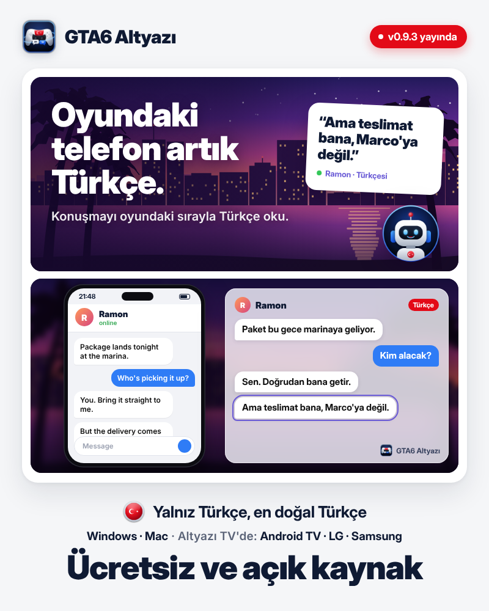</td>
<td width="33%">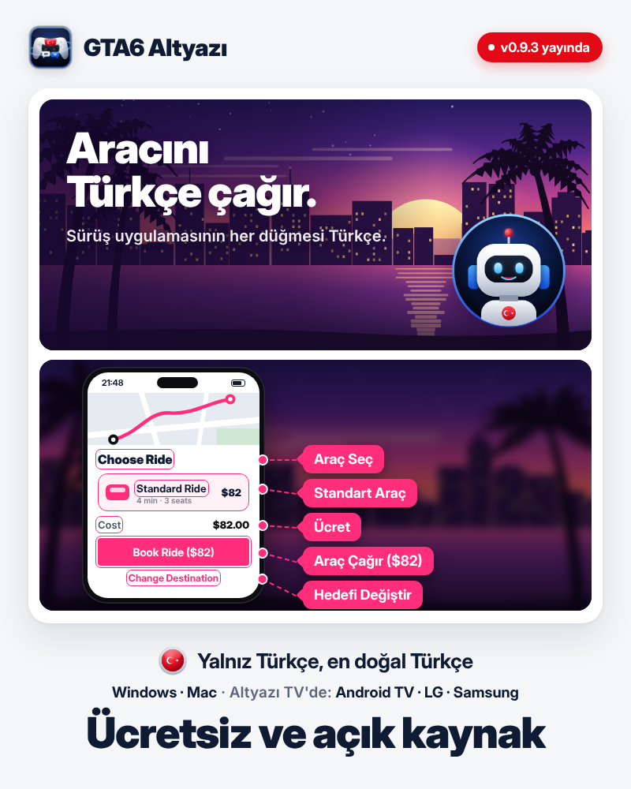</td>
<td width="33%">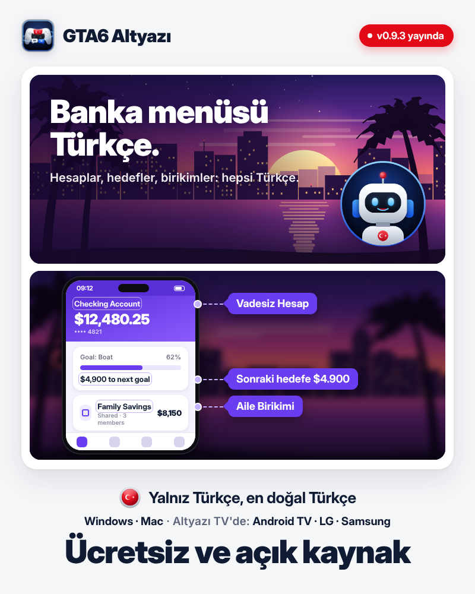</td>
</tr>
<tr>
<td>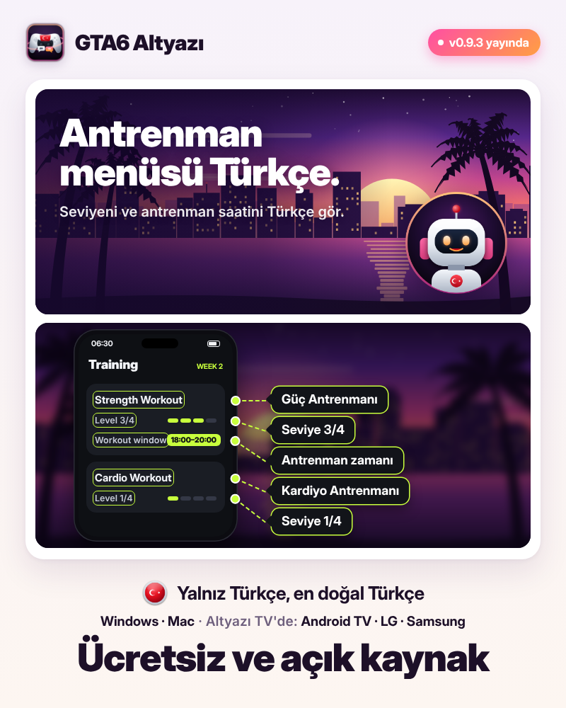</td>
<td>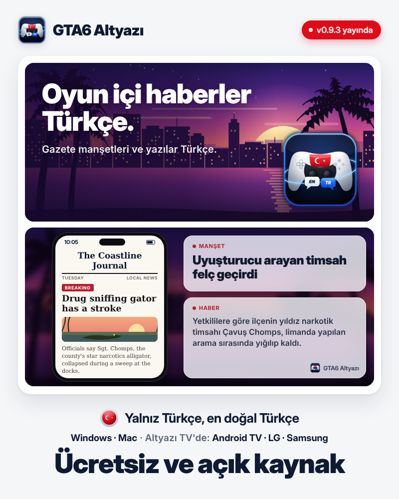</td>
<td>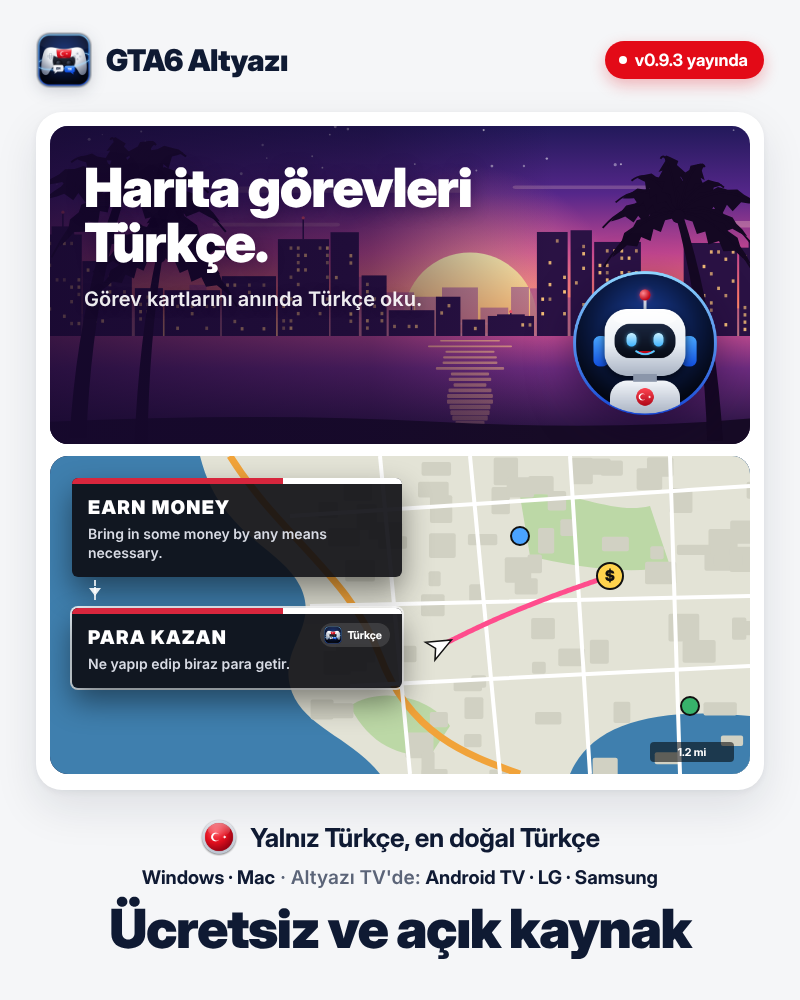</td>
</tr>
<tr>
<td>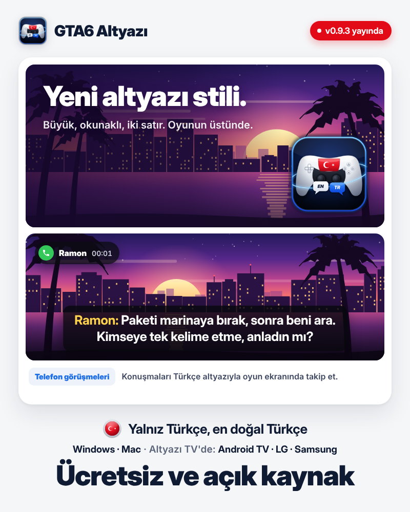</td>
<td>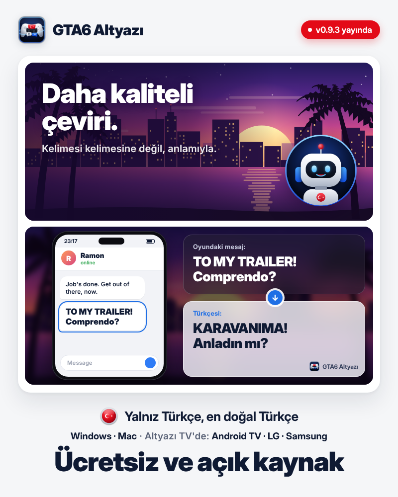</td>
<td>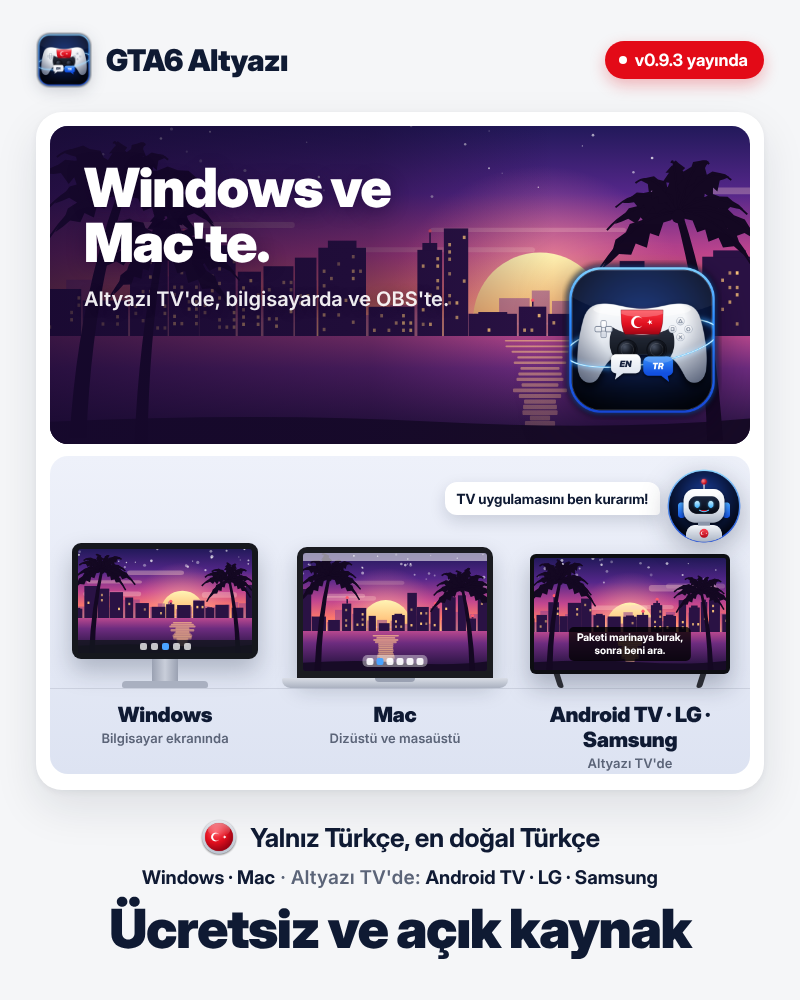</td>
</tr>
</table>

<sub>Tanıtım kartlarındaki oyun ekranları çizimdir; oyun görüntüsü ya da oyunun görselleri kullanılmadı.</sub>

## 🔌 "Fişi takın" ne demek?

<p align="center"></p>

## ✨ Öne çıkanlar

<table>
<tr>
<td width="50%" valign="top">

**⚡ Gecikme yok denecek kadar az**<br>
Daha önce görülen ya da pakette olan satır anında, yeni satır çoğunlukla yarım saniyenin altında gelir.

**🧠 İki katmanlı çeviri**<br>
Ekran kartındaki yerel model hız garantisi verir; üstündeki yapay zekâ argoyu, küfrü ve esprileri koruyarak doğal Türkçeye çevirir. Önceki diyaloglar bağlam olarak gider, isimler (Jason, Lucia, Vice City) çevrilmez.

**🆓 Ücretsiz kullanılabilir**<br>
Yerel model hep ücretsiz. Yapay zekâ için Claude'un yanında ücretsiz seçenekler var: Google Gemini (ücretsiz anahtar), DeepL Free ya da bilgisayarda çalışan Ollama.

**🖥️ Ekranın tamamı tek tuşla**<br>
Ctrl+Shift+9: menü, harita, telefon mesajı, tabela... Claude ekranı görerek okur.

</td>
<td width="50%" valign="top">

**📺 Tek bilgisayar, dört ekran**<br>
TV'de oyunun üstünde, bilgisayarda chiaki'nin üstünde, Discord yayınında ve OBS'de aynı anda.

**📦 Hazır çeviri paketleri**<br>
GTA 6, GTA V, RDR2 ve başka oyunların topluluk paketleri tek tıkla (CouchSubs ve GameTranslator). Pakette olan satır ücretsiz ve anında.

**🛡️ Gerçek oyun sorunlarına karşı**<br>
Görev yazısı ile diyalog ayrılır, OCR hatası yüzünden yanlış çeviri gelmez, yazı titremez.

</td>
</tr>
</table>

## 🧭 Nasıl çalışır

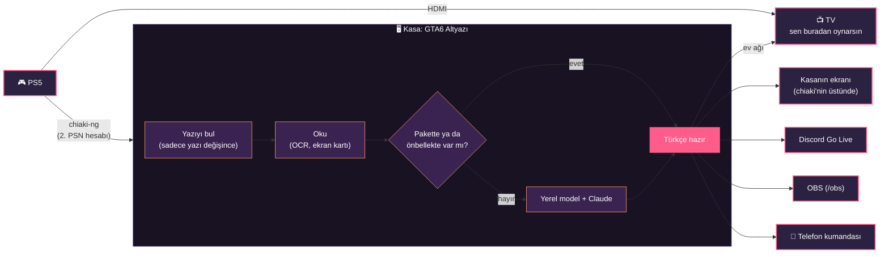

Sen TV'de HDMI'dan, hiç gecikmesiz oynarsın. Kasa aynı görüntüyü chiaki-ng ile ikinci bir PSN hesabından izler, yazıları okur, çevirir ve TV'deki uygulamaya gönderir. TV uygulaması Türkçeyi oyunun üstüne çizer.

### Ne kadar hızlı?

| Durum | Türkçe ne zaman çıkar |
|---|---|
| Daha önce görülmüş ya da pakette olan satır | **~0,05 saniye**, anında gibi |
| İlk kez görülen satır | **en geç ~0,4 saniye**. Claude zamanında gelmezse önce yerel modelin çevirisi çıkar, Claude'unki gelince yerine geçer |
| TV'de ek olarak | **~0,1 saniye**. Kasa görüntüyü chiaki üzerinden biraz geç aldığı için |

Her çevirinin süresi uygulamanın ana ekranında ve oyunun sağ üstünde görünür.

## 🪟 Uygulama

<table>
<tr>
<td width="50%"><br><sub><b>Ana ekran:</b> fişi prize tak (ya da kaydırmalı düğme), TV'de canlı Türkçe altyazı, ortalama gecikme, PS5/TV/motor durumu, telefon kumandası QR'ı</sub></td>
<td width="50%"><br><sub><b>Okuma alanları:</b> kutuları oyun görüntüsünün üstünde fareyle ayarla; yazı sayılan pikseller kırmızıyla görünür</sub></td>
</tr>
<tr>
<td width="50%"><br><sub><b>Televizyon:</b> TV'yi ağda bul, tek tıkla kur ve başlat, güvenlik duvarı izni</sub></td>
<td width="50%"><br><sub><b>Çeviri:</b> yerel model + Claude, deneme kutusu, sözlük, hazır paketler</sub></td>
</tr>
<tr>
<td width="50%">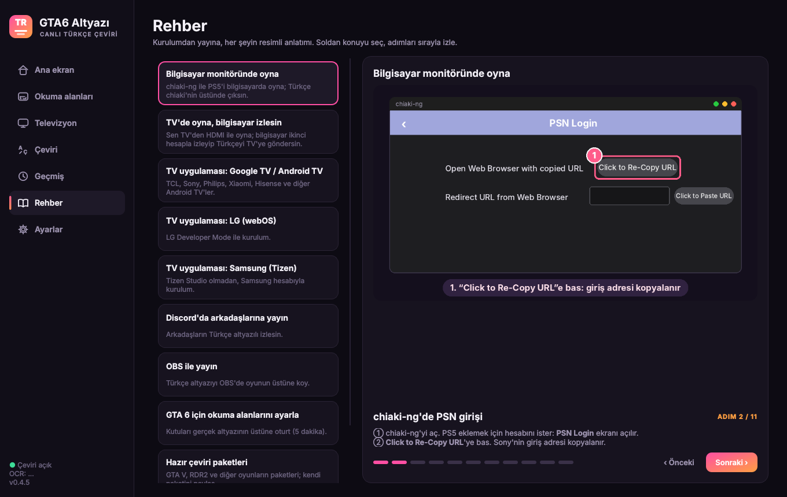<br><sub><b>Rehber:</b> kurulumdan yayına her süreç resimli, adım adım</sub></td>
<td width="50%">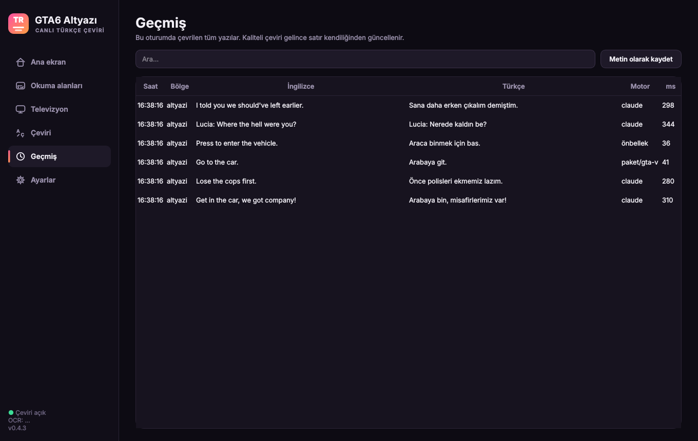<br><sub><b>Geçmiş:</b> oturumdaki bütün çeviriler, aranabilir ve kaydedilebilir</sub></td>
</tr>
</table>

| Sayfa | Ne yapar |
|---|---|
| **Ana ekran** | Büyük başlat/durdur düğmesi, gecikme grafiği, PS5/TV/çeviri motoru durumları, telefon kumandası QR kodu, kopyalanabilir canlı çeviri akışı |
| **Okuma alanları** | Bölgeleri fareyle taşı ve boyutlandır, hazır konumlar, Türkçe yazı boyutu ve İngilizceyi kapatan kutu |
| **Televizyon** | TV'yi ağda bulma, eşleştirme, kurma, mod seçimi, deneme altyazısı, güvenlik duvarı izni |
| **Çeviri** | Yerel model / Google, Claude / Gemini / DeepL, API anahtarı, deneme çevirisi, sözlük, hazır çeviri paketleri |
| **Geçmiş** | Oturumdaki bütün çeviriler; aranabilir, metin olarak kaydedilebilir |
| **Rehber** | Kurulumdan yayına bütün süreçler resimli, adım adım (bu sayfadaki rehberle aynı) |
| **Ayarlar** | Görüntü kaynağı (chiaki / capture kart), gösterim, kısayollar, otomatik başlatma, OBS adresi |

## 📥 İndir ve kur

1. **[Releases](https://github.com/CH4P4R/gta6-altyazi/releases)** sayfasından en son `GTA6Altyazi-Setup.exe`'yi indir.
2. Çalıştır. Yönetici izni istemez. "Windows kişisel bilgisayarınızı korudu" uyarısı çıkarsa **Ek bilgi › Yine de çalıştır**'a bas.
3. İlk açılışta resimli kurulum sihirbazı karşılar: nerede oynayacağın, PS5 ve chiaki-ng, TV, çeviri (Claude anahtarı) ve hazır.

Kurulumun içinde her şey var: yerel çeviri modeli (internetsiz çalışır), OCR, TV uygulamaları ve TV'ye kurmak için gereken araçlar. Ayrıca bir şey indirmen gerekmez.

> [!NOTE]
> Yapay zekâ anahtarı isteğe bağlı: ücretsiz [Gemini anahtarı](https://aistudio.google.com/apikey), [DeepL API Free](https://www.deepl.com/pro-api), anahtarsız [Ollama](https://ollama.com/download) ya da ücretli [Claude](https://console.anthropic.com/settings/keys). Anahtar sadece senin bilgisayarında saklanır. Hiçbirini girmezsen uygulama yerel modelle ücretsiz çalışır.

## 🗺️ Kurulum yolculuğu

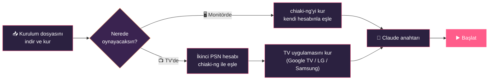

Uygulamayı ilk açtığında **resimli kurulum sihirbazı** bu yolu adım adım yürütür; her adımda neye basacağın resimde işaretlidir. Sonradan bir şeye bakmak istersen uygulamadaki **Rehber** sayfası aynı anlatımı her zaman açık tutar.

<table>
<tr>
<td width="50%">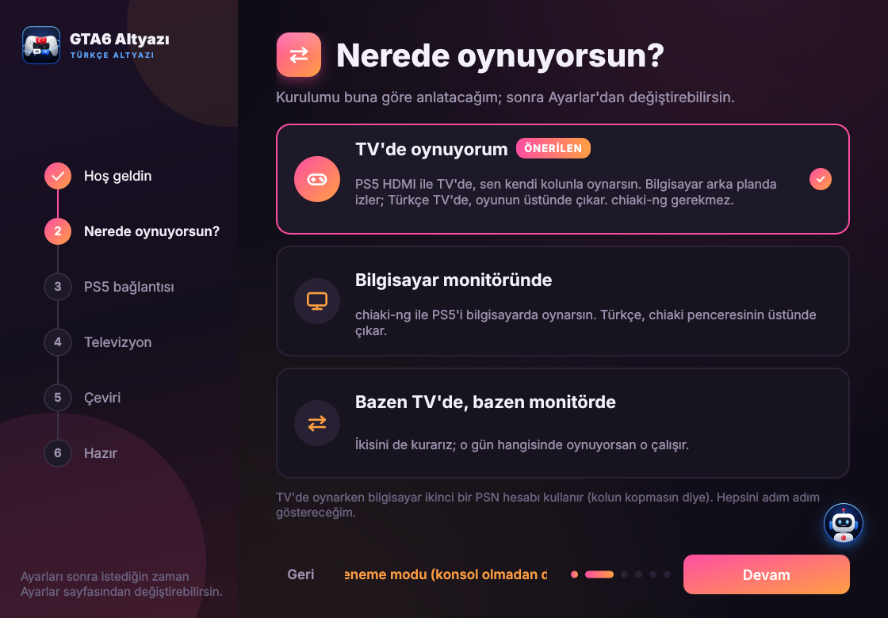<br><sub><b>Sihirbaz:</b> nerede oynayacağını seç, anlatım ona göre değişsin</sub></td>
<td width="50%">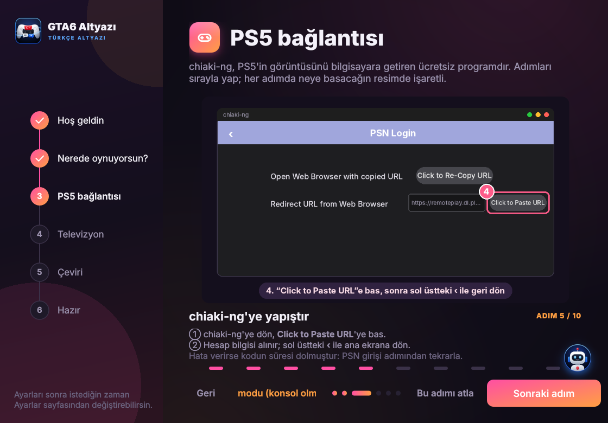<br><sub><b>Sihirbaz:</b> her adım resimli; neye basacağın işaretli</sub></td>
</tr>
</table>

## 📖 Adım adım rehber

<!-- REHBER:BASLA -->

> Bu bölüm uygulamadaki **Rehber** sayfasıyla aynıdır (kaynak: `altyazi/rehber.py`). Uygulamada da soldaki menüden **Rehber**'e girip aynı adımları resimli izleyebilirsin.

| Konu | Ne anlatıyor |
|---|---|
| • [TV'de oyna (chiaki'siz, önerilen)](#rehber-tv-arka-plan) | PS5 HDMI ile TV'de; bilgisayar PS5'e arka planda ikinci hesapla bağlanır, Türkçe TV'de çıkar. |
| 🖥️ [Bilgisayar monitöründe oyna](#rehber-monitor) | chiaki-ng ile PS5'i bilgisayarda oyna; Türkçe chiaki'nin üstünde çıksın. |
| 📺 [TV'de oyna, bilgisayar izlesin](#rehber-tv-izle) | Sen TV'den HDMI ile oyna; bilgisayar ikinci hesapla izleyip Türkçeyi TV'ye göndersin. |
| 🎞️ [Capture kart ile oyna](#rehber-capture) | Elgato, AVerMedia ya da USB HDMI kartla: görüntü TV'ye geçer, Türkçe TV'de ya da bilgisayarda. |
| 🔌 ["Fişi takın" ne demek?](#rehber-fis) | Ana ekrandaki fiş, programın Başlat düğmesidir. |
| • [Mac'te kullanım (Apple Silicon)](#rehber-mac) | M1 ve sonrası Mac'lerde kurulum, chiaki-ng ve macOS izinleri. |
| 🤖 [TV uygulaması: Google TV / Android TV](#rehber-google-tv) | TCL, Sony, Philips, Xiaomi, Hisense ve diğer Android TV'ler. |
| 📺 [TV uygulaması: LG (webOS)](#rehber-lg) | LG Developer Mode ile kurulum. |
| 📺 [TV uygulaması: Samsung (Tizen)](#rehber-samsung) | Tizen Studio olmadan, Samsung hesabıyla kurulum. |
| 💬 [Discord'da arkadaşlarına yayın](#rehber-discord) | Arkadaşların Türkçe altyazılı izlesin. |
| 🎥 [OBS ile yayın](#rehber-obs) | Türkçe altyazıyı OBS'de oyunun üstüne koy. |
| 🎯 [GTA 6 için okuma alanlarını ayarla](#rehber-gta6) | Kutuları gerçek altyazının üstüne oturt (5 dakika). |
| 🆓 [Ücretsiz çeviri (Gemini, DeepL, Ollama)](#rehber-ucretsiz) | Claude şart değil: ücretsiz yapay zekâ seçenekleri ve arkadaşlarla paylaşım. |
| 📦 [Hazır çeviri paketleri](#rehber-paketler) | GTA 6, GTA V, RDR2 ve diğer oyunların paketleri; kendi paketini paylaş. |
| 🔄 [Güncellemeler](#rehber-guncelleme) | Paketler sessizce, uygulama tek tıkla güncellenir; yeniden kurmak gerekmez. |
| 🧰 [Sorun giderme](#rehber-sorunlar) | TV bağlanmıyor, altyazı çıkmıyor, yazı kayık... |

<a name="rehber-tv-arka-plan"></a>
<details>
<summary><b>• TV'de oyna (chiaki'siz, önerilen)</b> · PS5 HDMI ile TV'de; bilgisayar PS5'e arka planda ikinci hesapla bağlanır, Türkçe TV'de çıkar.</summary>

#### Adım 1: İkinci PSN hesabı (bir kez)

1. playstation.com'da **farklı bir e-postayla** ücretsiz yeni hesap aç (PS Plus gerekmez).
2. PS5'te **Kullanıcı Ekle** de, yeni hesapla bir kez oturum aç.
3. Hâlâ yeni kullanıcıyken: **Ayarlar › Sistem › Uzaktan Oynatma › Uzaktan Oynatmayı Etkinleştir**'i aç.
4. Aynı yerde **Uzaktan Oynatma Bağlantı Durumu Açılır Penceresini Gizle**'yi aç (iki hesapta da), ekranda "bağlandı" yazısı çıkmasın.

> Neden ikinci hesap? Bilgisayar oyunu Remote Play'den izler. Kendi hesabınla bağlansaydı PS5 kolunu kapatırdı; ikinci hesapla sen oynamaya devam edersin.

#### Adım 2: Programda ikinci hesapla giriş

1. Ana ekranda PS5 kartındaki **TV'de oynuyorum (chiaki'siz)**'e bas (ya da Ayarlar › Görüntü kaynağı › **PS5'i bağla**).
2. **Sony giriş sayfasını aç**'a bas, **ikinci hesapla** giriş yap.
3. Giriş bitince tarayıcı yalnız *redirect* yazan bir sayfada kalır (bu normal). Adres çubuğundaki adresin **tamamını** kopyala; program kendisi alır.

#### Adım 3: PS5'i eşle (bir kez)

1. PS5'te **ikinci kullanıcıya geç**.
2. **Ayarlar › Sistem › Uzaktan Oynatma › Cihazı Eşleştir**'i aç; ekranda 8 haneli kod çıkar.
3. Programda PS5'ini seç, kodu yaz, **Eşle**'ye bas (30 saniyeye kadar sürer).
4. Bitince PS5'te **kendi kullanıcına geri dön**.

#### Adım 4: Oyna

1. PS5'i aç, kolu açınca **kendi (ana) hesabını** seç ve oyna.
2. Program PS5'in açıldığını görür, arka planda bağlanır ve çeviriyi kendisi başlatır; Türkçe TV'de çıkar.
3. TV uygulaması kurulu değilse önce Rehber › TV uygulaması adımlarını yap.

> PS5'i kapatınca (dinlenme modu) bağlantı bekler; PS5 açılınca kendiliğinden yeniden bağlanır. Kablosuz ağda görüntü sık koparsa program kendiliğinden 720p'ye geçer; kalıcı çözüm PS5'i modeme kabloyla bağlamak.

</details>

<a name="rehber-monitor"></a>
<details>
<summary><b>🖥️ Bilgisayar monitöründe oyna</b> · chiaki-ng ile PS5'i bilgisayarda oyna; Türkçe chiaki'nin üstünde çıksın.</summary>

#### Adım 1: chiaki-ng'yi indir ve kur

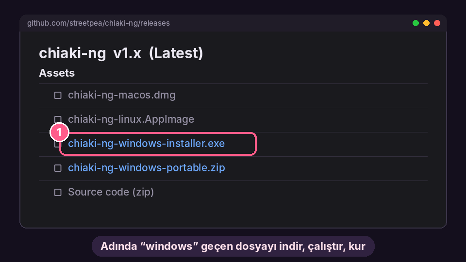

1. **İndirme sayfasını aç**'a bas.
2. En üstteki sürümün **Assets** listesinde adında **windows** geçen dosyayı indir.
3. İndirdiğin dosyayı çalıştırıp kur.

🔗 [İndirme sayfasını aç](https://github.com/streetpea/chiaki-ng/releases)

> chiaki-ng, PS5'in görüntüsünü ağ üzerinden bilgisayara getiren ücretsiz programdır.

#### Adım 2: chiaki-ng'de PSN girişi


1. chiaki-ng'yi aç. PS5 eklemek için hesabını ister: **PSN Login** ekranı açılır.
2. **Click to Re-Copy URL**'ye bas. Sony'nin giriş adresi kopyalanır.

#### Adım 3: Tarayıcıda giriş yap

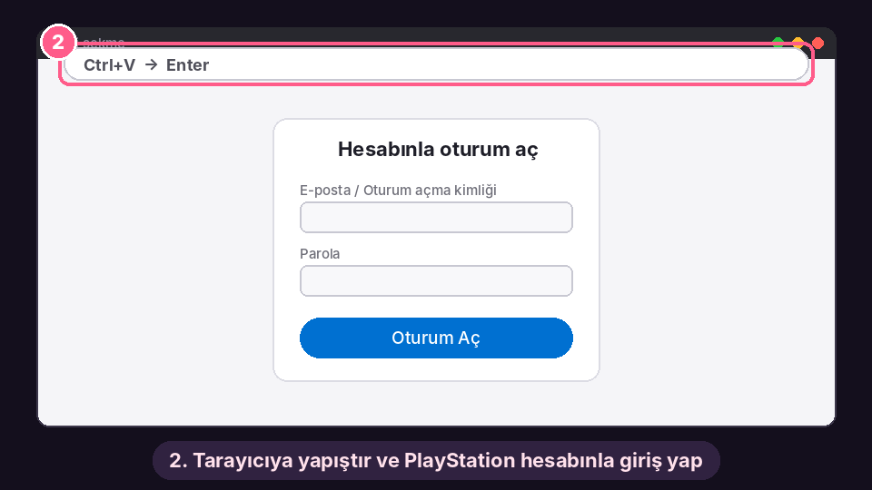

1. Chrome ya da Edge'i aç, adres çubuğuna tıkla, **Ctrl+V** yap ve **Enter**'a bas.
2. Açılan PlayStation sayfasında **Kendi PlayStation hesabınla** giriş yap (oyunların ve kayıtların o hesapta).

#### Adım 4: Açılan sayfanın adresini kopyala

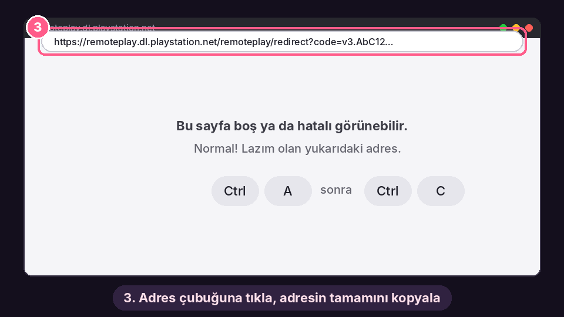

1. Giriş bitince boş ya da hatalı görünen bir sayfa açılır. **Bu normal.**
2. Adres çubuğuna tıkla (adres *remoteplay.dl.playstation.net/…redirect?code=* ile başlar).
3. **Ctrl+A**, sonra **Ctrl+C** yap.

> Bu kod birkaç dakika geçerli, hızlı ol.

#### Adım 5: chiaki-ng'ye yapıştır


1. chiaki-ng'ye dön, **Click to Paste URL**'ye bas.
2. Hesap bilgisi alınır; sol üstteki **‹** ile ana ekrana dön.

> Hata verirse kodun süresi dolmuştur: PSN girişi adımından tekrarla.

#### Adım 6: PS5'te bağlantı kodunu al


1. PS5'te chiaki'ye girdiğin hesapla oturum açıkken **Ayarlar › Sistem › Uzaktan Oynatma**: **Uzaktan Oynatmayı Etkinleştir** açık olsun.
2. **Cihazı Bağla**'ya bas; 8 haneli bir kod çıkar (ekranda bırak).
3. **Ayarlar › Sistem › Güç Tasarrufu › Dinlenme Modunda Kullanılabilir Özellikler**: **İnternete Bağlı Kal** ve **Ağ Üzerinden PS5'i Açmayı Etkinleştir**'i aç.

> TV'de oynayacaksan Uzaktan Oynatma ayarlarındaki bağlantı durumu açılır penceresini gizle; yoksa chiaki bağlanınca TV ekranında "bağlandı" yazısı çıkar.

#### Adım 7: PS5'i chiaki-ng'ye kaydet


1. chiaki-ng ana ekranında PS5'in kutusuna tıkla.
2. **PIN** kutusuna PS5'teki 8 haneli kodu yaz.
3. **Register**'a bas.

> PS5 görünmüyorsa PS5 ve bilgisayar aynı modeme bağlı mı bak; sağ üstteki + ile IP'siyle de eklenir.

#### Adım 8: Görüntü ayarları (bir kere)

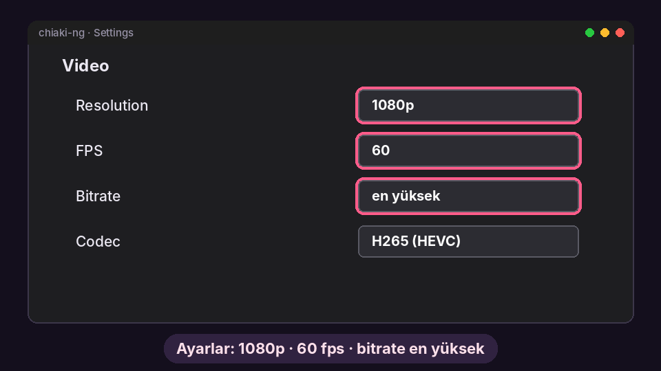

1. chiaki-ng ayarlarında (dişli simgesi) **Video** bölümüne gir.
2. **Resolution: 1080p**, **FPS: 60** seç.
3. **Bitrate**'i en yükseğe al.

> Yazıların net okunması için bu önemli.

#### Adım 9: Kolu bilgisayara bağla

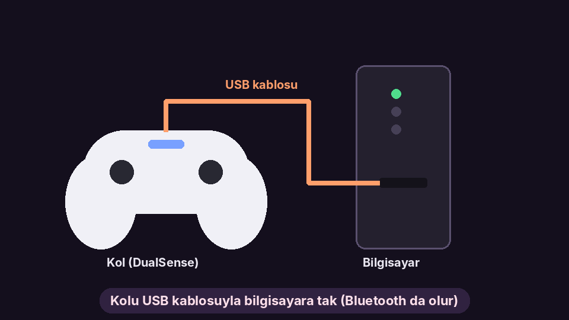

1. DualSense'i **USB kablosuyla** bilgisayara tak (titreşim de çalışır). Bluetooth da olur.

#### Adım 10: Bağlan


1. chiaki-ng'de PS5'in kutusuna tıkla; PS5'in ekranı açılır, kolla oynarsın.
2. İstersen **F11** ile tam ekran yap.

#### Adım 11: Türkçeyi aç

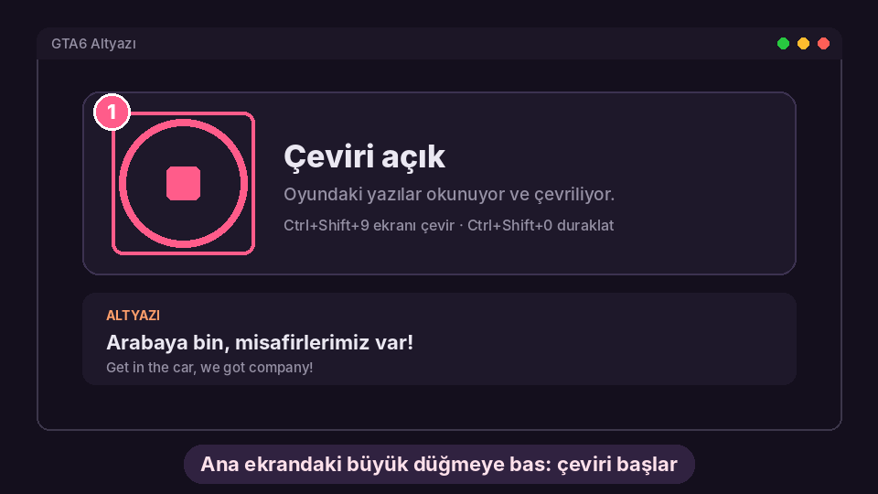

1. **GTA6 Altyazı**'yı aç.
2. Ana ekrandaki büyük düğmeye (**Başlat**) bas.
3. Oyunda İngilizce altyazıyı aç; yazılar Türkçe görünür.

> Kısayollar: Ctrl+Shift+9 ekranın tamamını çevirir, Ctrl+Shift+0 duraklatır.

</details>

<a name="rehber-tv-izle"></a>
<details>
<summary><b>📺 TV'de oyna, bilgisayar izlesin</b> · Sen TV'den HDMI ile oyna; bilgisayar ikinci hesapla izleyip Türkçeyi TV'ye göndersin.</summary>

#### Adım 1: İkinci PSN hesabı aç (ücretsiz)

1. Ücretsiz yeni bir PlayStation hesabı aç.
2. PS5'i aç ve bu yeni hesapla **bir kez** oturum aç.

🔗 [PSN hesabı aç](https://www.playstation.com/tr-tr/playstation-network/)

> TV'de oynarken bilgisayar PS5'i ikinci bir hesapla izler; kendi hesabınla bağlanırsa TV'deki kolun kopar.

#### Adım 2: chiaki-ng'yi indir ve kur


1. **İndirme sayfasını aç**'a bas.
2. En üstteki sürümün **Assets** listesinde adında **windows** geçen dosyayı indir.
3. İndirdiğin dosyayı çalıştırıp kur.

🔗 [İndirme sayfasını aç](https://github.com/streetpea/chiaki-ng/releases)

> chiaki-ng, PS5'in görüntüsünü ağ üzerinden bilgisayara getiren ücretsiz programdır.

#### Adım 3: chiaki-ng'de PSN girişi


1. chiaki-ng'yi aç. PS5 eklemek için hesabını ister: **PSN Login** ekranı açılır.
2. **Click to Re-Copy URL**'ye bas. Sony'nin giriş adresi kopyalanır.

#### Adım 4: Tarayıcıda giriş yap


1. Chrome ya da Edge'i aç, adres çubuğuna tıkla, **Ctrl+V** yap ve **Enter**'a bas.
2. Açılan PlayStation sayfasında **İkinci PSN hesabınla** giriş yap. Kendi hesabınla girersen TV'de oynarken kolun kopar.

#### Adım 5: Açılan sayfanın adresini kopyala


1. Giriş bitince boş ya da hatalı görünen bir sayfa açılır. **Bu normal.**
2. Adres çubuğuna tıkla (adres *remoteplay.dl.playstation.net/…redirect?code=* ile başlar).
3. **Ctrl+A**, sonra **Ctrl+C** yap.

> Bu kod birkaç dakika geçerli, hızlı ol.

#### Adım 6: chiaki-ng'ye yapıştır


1. chiaki-ng'ye dön, **Click to Paste URL**'ye bas.
2. Hesap bilgisi alınır; sol üstteki **‹** ile ana ekrana dön.

> Hata verirse kodun süresi dolmuştur: PSN girişi adımından tekrarla.

#### Adım 7: PS5'te bağlantı kodunu al


1. PS5'te chiaki'ye girdiğin hesapla oturum açıkken **Ayarlar › Sistem › Uzaktan Oynatma**: **Uzaktan Oynatmayı Etkinleştir** açık olsun.
2. **Cihazı Bağla**'ya bas; 8 haneli bir kod çıkar (ekranda bırak).
3. **Ayarlar › Sistem › Güç Tasarrufu › Dinlenme Modunda Kullanılabilir Özellikler**: **İnternete Bağlı Kal** ve **Ağ Üzerinden PS5'i Açmayı Etkinleştir**'i aç.

> TV'de oynayacaksan Uzaktan Oynatma ayarlarındaki bağlantı durumu açılır penceresini gizle; yoksa chiaki bağlanınca TV ekranında "bağlandı" yazısı çıkar.

#### Adım 8: PS5'i chiaki-ng'ye kaydet


1. chiaki-ng ana ekranında PS5'in kutusuna tıkla.
2. **PIN** kutusuna PS5'teki 8 haneli kodu yaz.
3. **Register**'a bas.

> PS5 görünmüyorsa PS5 ve bilgisayar aynı modeme bağlı mı bak; sağ üstteki + ile IP'siyle de eklenir.

#### Adım 9: Görüntü ayarları (bir kere)


1. chiaki-ng ayarlarında (dişli simgesi) **Video** bölümüne gir.
2. **Resolution: 1080p**, **FPS: 60** seç.
3. **Bitrate**'i en yükseğe al.

> Yazıların net okunması için bu önemli.

#### Adım 10: Bağlan


1. chiaki-ng'de PS5'in kutusuna tıkla. Sen TV'den oynamaya devam et; chiaki açık kalsın.
2. chiaki penceresini **simge durumuna küçültme**, program görüntüyü oradan okuyor.

#### Adım 11: Türkçeyi aç


1. **GTA6 Altyazı**'yı aç.
2. Ana ekrandaki büyük düğmeye (**Başlat**) bas.
3. Oyunda İngilizce altyazıyı aç; yazılar Türkçe görünür.

> Kısayollar: Ctrl+Shift+9 ekranın tamamını çevirir, Ctrl+Shift+0 duraklatır.

</details>

<a name="rehber-capture"></a>
<details>
<summary><b>🎞️ Capture kart ile oyna</b> · Elgato, AVerMedia ya da USB HDMI kartla: görüntü TV'ye geçer, Türkçe TV'de ya da bilgisayarda.</summary>

#### Adım 1: Kabloları bağla

1. PS5'in HDMI kablosunu capture kartın **HDMI IN** girişine tak.
2. Kartın **HDMI OUT** (passthrough) çıkışını TV'ye bağla: görüntü TV'ye gecikmesiz geçer.
3. Kartın USB kablosunu bilgisayara tak (Elgato HD60 / 4K, AVerMedia Live Gamer, USB HDMI kartlar).

> PS5'te Ayarlar › Sistem › HDMI › **HDCP'yi Etkinleştir**'i kapat; açıkken capture kart görüntüyü siyah verir.

#### Adım 2: Programda kartı seç

1. **Bağlantı › Görüntü kaynağı**'nda **Yakalama kartı**'nı seç.
2. **Aygıtları ara**'ya bas: kartlar adıyla listelenir, capture kart olan kendiliğinden seçilir.
3. **Önizle** ile oyunun görüntüsünün geldiğini gör. Görüntü: 1080p · 60 kare (eski kartta 720p).

#### Adım 3: Oyunu nerede oynayacaksın

1. **TV'de oynuyorum:** görüntü TV'ye kartın HDMI çıkışından gider; Türkçe TV uygulamasında oyunun üstünde çıkar (Rehber › TV uygulaması).
2. **Bilgisayar ekranında:** görüntü ve Türkçe bu programın penceresinde birlikte açılır. **Capture kartın sesini hoparlöre aktar** açıkken oyunun sesi bilgisayardan gelir; ses gelmezse **Ses girişlerini ara**'dan kartın girişini seç.

#### Adım 4: Kaydet ve başlat

1. **Kaydet**'e bas, sonra ana ekranda fişi prize tak (ya da Çeviriyi Başlat).
2. İlk açılışta macOS kamera ve mikrofon izni ister: capture kartın görüntüsü ve sesi için **İzin Ver**.

</details>

<a name="rehber-fis"></a>
<details>
<summary><b>🔌 "Fişi takın" ne demek?</b> · Ana ekrandaki fiş, programın Başlat düğmesidir.</summary>

#### Adım 1: "Fişi takın" ne demek?

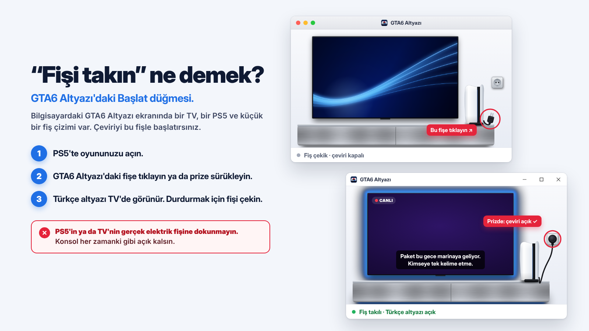

1. Ana ekrandaki TV, PS5 ve küçük fiş çizimi programın **Başlat düğmesidir**.
2. **Fişe tıkla** ya da prize sürükle: çeviri başlar, TV'nin arkası mavi yanar, ekranda ● CANLI çıkar.
3. Durdurmak için fişi çek (ya da yeniden tıkla). İstersen Altyazı görünümü › Ana ekran'dan **Cam düğme**'ye geç: kırmızı düğmeyi sağa kaydırınca açılır.

> PS5'in ya da TV'nin gerçek elektrik fişine dokunma; konsol her zamanki gibi açık kalsın.

</details>

<a name="rehber-mac"></a>
<details>
<summary><b>• Mac'te kullanım (Apple Silicon)</b> · M1 ve sonrası Mac'lerde kurulum, chiaki-ng ve macOS izinleri.</summary>

#### Adım 1: GTA6 Altyazı'yı kur

1. Releases sayfasından **GTA6Altyazi-mac.dmg**'yi indir ve aç (yalnız Apple Silicon: M1 ve sonrası).
2. Açılan pencerede **GTA6 Altyazı**'yı **Applications** (Uygulamalar) klasörüne sürükle.
3. Uygulamalar'dan **GTA6 Altyazı**'yı aç.
4. "Apple doğrulayamadı" uyarısı çıkarsa **Bitti**'ye bas; **Sistem Ayarları › Gizlilik ve Güvenlik**'in en altında **GTA6 Altyazı engellendi** yazısının yanındaki **Yine de Aç**'a bas, Mac şifreni gir. Bunu yalnız ilk açılışta bir kez yaparsın.

🔗 [Releases sayfası](https://github.com/CH4P4R/gta6-altyazi/releases)

> Mac'te NVIDIA yok: çeviri ve OCR işlemcide çalışır; M serisi Mac'lerde bu yeterince hızlı. Güncellemeyi program kendisi kurar ve yeniden açar.

#### Adım 2: chiaki-ng'yi kur

1. chiaki-ng'nin indirme sayfasından **macOS** sürümünü (.dmg) indir, Uygulamalar'a sürükle.
2. PS5 eşleme adımları Windows'takiyle aynı (Rehber › Bilgisayar monitöründe oyna).

🔗 [chiaki-ng indirme sayfası](https://github.com/streetpea/chiaki-ng/releases)

#### Adım 3: İzinleri ver

1. **Ekran Kaydı:** Çeviri başlayınca macOS sorar. **Sistem Ayarları › Gizlilik ve Güvenlik › Ekran ve Sistem Ses Kaydı**'nda **GTA6 Altyazı**'yı aç, programı kapatıp yeniden aç. chiaki penceresini okumak için gerekir.
2. **Erişilebilirlik:** Kısayol tuşları (Control+Shift+9 ekranı çevir) için **Gizlilik ve Güvenlik › Erişilebilirlik**'te **GTA6 Altyazı**'yı aç.
3. **Yerel Ağ:** TV'ye bağlanırken macOS sorarsa **İzin Ver** de.

> İzin verdikten sonra programı kapatıp yeniden açman gerekir; macOS izni ancak yeniden açılışta tanır. Güncellemeden sonra çeviri başlamazsa Ekran Kaydı listesinde GTA6 Altyazı'yı kapatıp yeniden aç.

#### Adım 4: Oyna


1. chiaki-ng'de PS5'e bağlan, istersen tam ekran yap.
2. GTA6 Altyazı'da **Başlat**'a bas; Türkçe chiaki'nin üstünde, tam ekranda da görünür.
3. TV kurulumları (Google TV, LG, Samsung) Mac'te de aynı adımlarla yapılır.

</details>

<a name="rehber-google-tv"></a>
<details>
<summary><b>🤖 TV uygulaması: Google TV / Android TV</b> · TCL, Sony, Philips, Xiaomi, Hisense ve diğer Android TV'ler.</summary>

#### Adım 1: TV'de geliştirici seçeneklerini aç

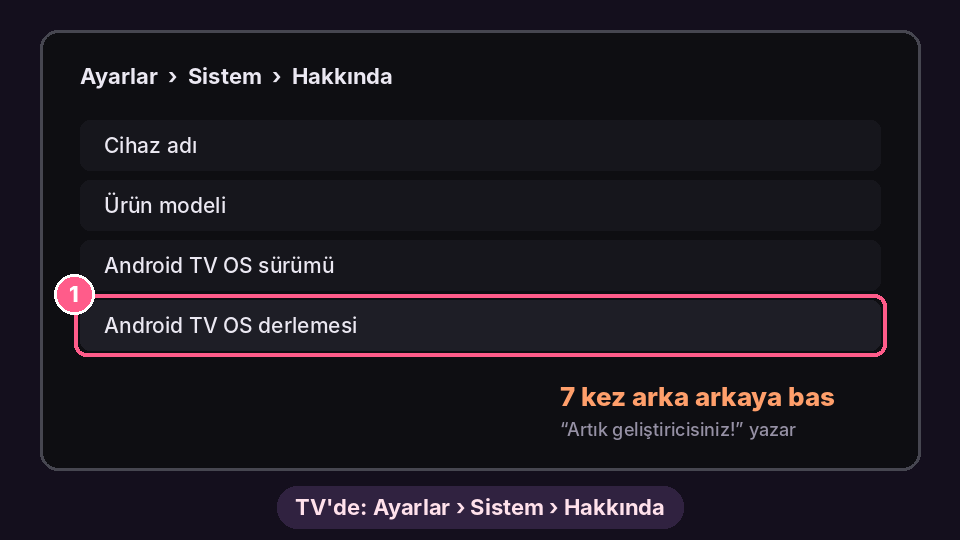

1. TV kumandasıyla **Ayarlar › Sistem › Hakkında**'ya gir.
2. **Android TV OS derlemesi** satırına gel ve **OK**'a arka arkaya **7 kez** bas. "Artık geliştiricisiniz" yazar.

> TCL'de menü adları biraz farklı olabilir: Ayarlar › Sistem › Hakkında › Derleme / Yapı numarası.

#### Adım 2: USB hata ayıklamayı aç

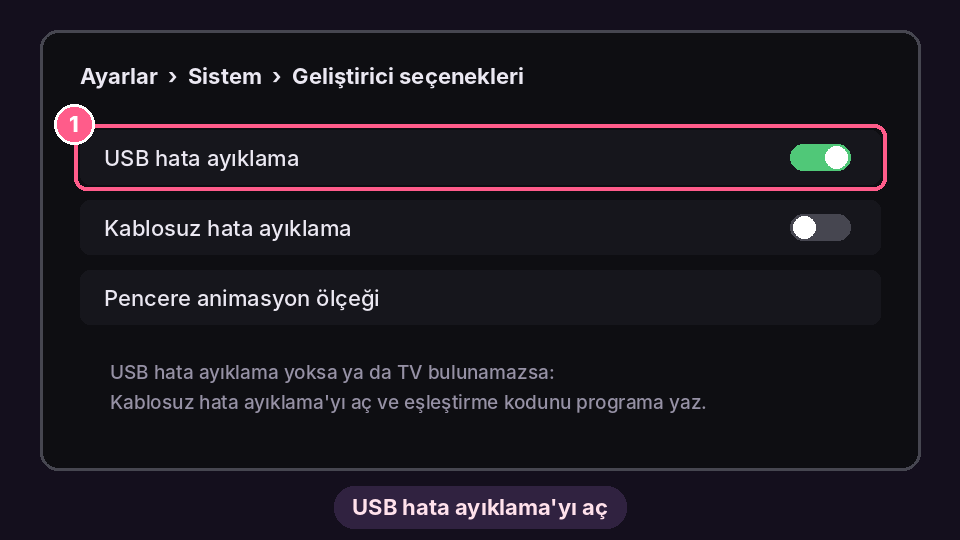

1. **Ayarlar › Sistem › Geliştirici seçenekleri**'ne gir.
2. **USB hata ayıklama**'yı aç (düz olanı; Kablosuz hata ayıklama gerekmez).
3. Eşleştirme kodu da gerekmez: program TV'ye ağdan doğrudan bağlanır.

> Yalnız TV'de USB hata ayıklama hiç yoksa: Kablosuz hata ayıklama › 'Eşleştirme koduyla cihaz eşleştir'; açılan küçük penceredeki adres:port ve kodu programdaki Gelişmiş › Eşleştir kısmına yaz.

#### Adım 3: Bağlan ve izin ver


1. Programda **Ağda ara**'ya bas ve listeden TV'yi seç. Bulamazsa TV'nin IP'sini elle yaz: TV'de **Ayarlar › Ağ ve İnternet**'te bağlı olduğun Wi-Fi'ye gir, IP adresi orada yazar.
2. **Bağlan, kur ve başlat**'a bas (kurulum sihirbazında: **Bağlan ve kur**).
3. TV'de çıkan soruda **Bu bilgisayardan her zaman izin ver**'i işaretle, **İzin ver**'e bas.

> TV ile bilgisayar aynı modeme bağlı olmalı. TV uygulaması PS5'in HDMI'ını kendisi bulur; TV HDMI'yı öne alırsa ya da görüntü siyah kalırsa kendiliğinden katman moduna geçer.

#### Adım 4: Tek resimde özet

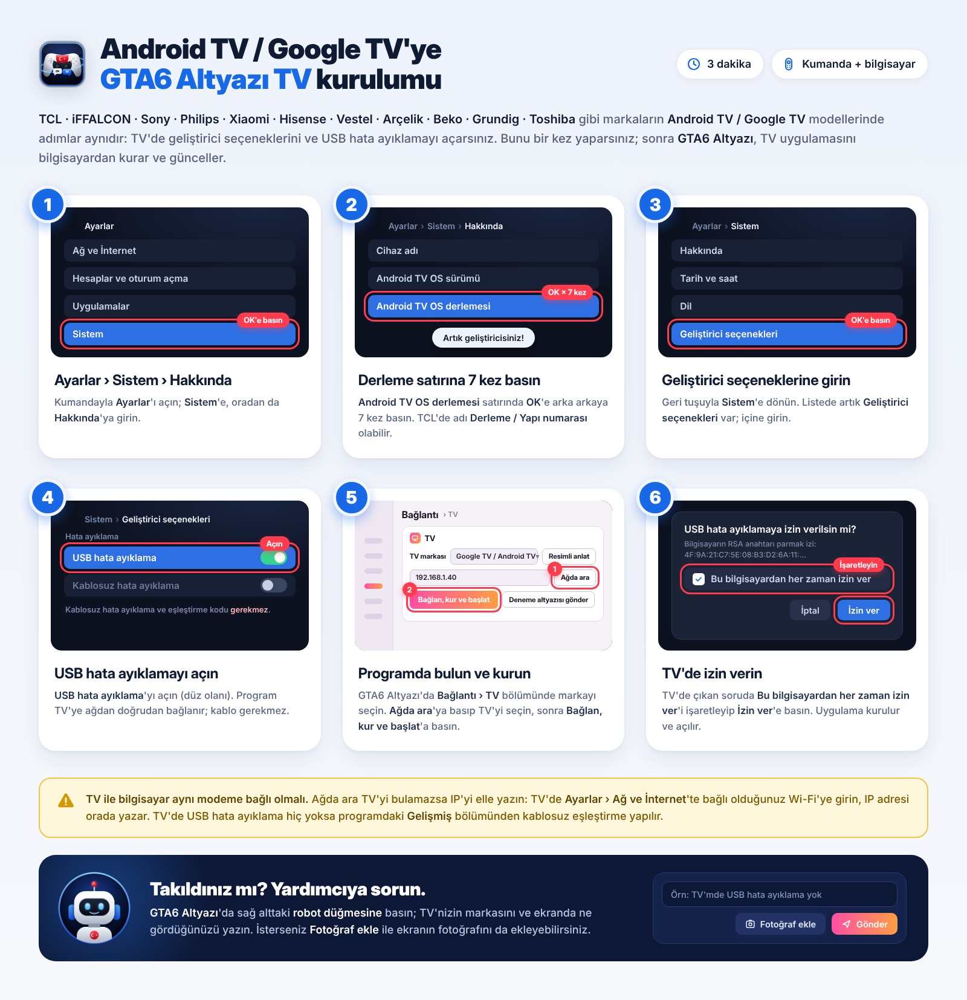

1. Bütün adımlar bir arada: yazdırıp TV'nin yanında tutabilirsin.
2. Bunu bir kez yaparsın; sonra program TV uygulamasını kendisi kurar ve günceller.

</details>

<a name="rehber-lg"></a>
<details>
<summary><b>📺 TV uygulaması: LG (webOS)</b> · LG Developer Mode ile kurulum.</summary>

#### Adım 1: LG geliştirici hesabı aç (ücretsiz)

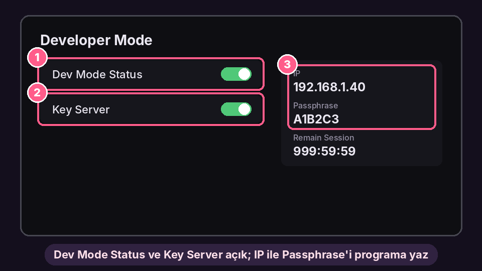

1. Bilgisayarda LG'nin geliştirici sitesini aç ve **Sign Up** ile ücretsiz hesap aç.
2. E-postana gelen onayı tamamla. Bu kullanıcı adı ve şifreyi TV'de kullanacaksın.

🔗 [LG geliştirici sitesi](https://webostv.developer.lge.com/)

> Normal LG hesabın değil, geliştirici sitesinden açılan hesap gerekir.

#### Adım 2: TV'ye Developer Mode uygulamasını kur

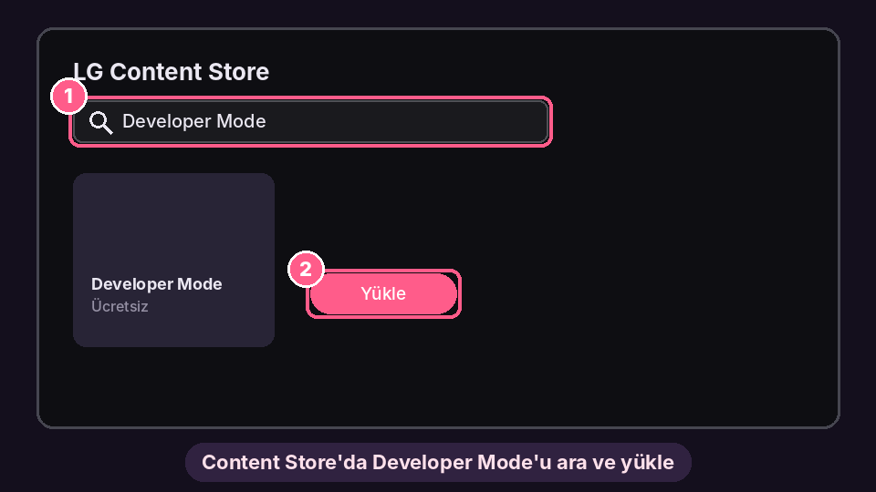

1. TV'de **LG Content Store**'u (Uygulamalar) aç.
2. Aramaya **Developer Mode** yaz, ücretsiz uygulamayı **Yükle**.

#### Adım 3: Developer Mode'u aç


1. **Developer Mode** uygulamasını aç, geliştirici hesabınla gir.
2. **Dev Mode Status**'u aç; TV yeniden başlar.
3. Uygulamayı tekrar aç ve **Key Server**'ı da aç. Ekranda **IP** ve **Passphrase** görünür.

> Geliştirici modu en çok 1000 saat açık kalır; program her bağlanışta süreyi kendisi baştan başlatır.

#### Adım 4: Programdan kur


1. Developer Mode ekranındaki **IP**'yi ve **Passphrase**'i programa yaz.
2. **Bağlan, kur ve başlat**'a bas (kurulum sihirbazında: **Bağlan ve kur**); uygulama kurulur ve açılır.
3. LG başka uygulamanın üstüne yazı çizmeye izin vermez: PS5 görüntüsü bizim uygulamanın içinde açılır. Kumandada **◀ ▶** ile PS5'in takılı olduğu HDMI girişini seç.

#### Adım 5: Tek resimde özet

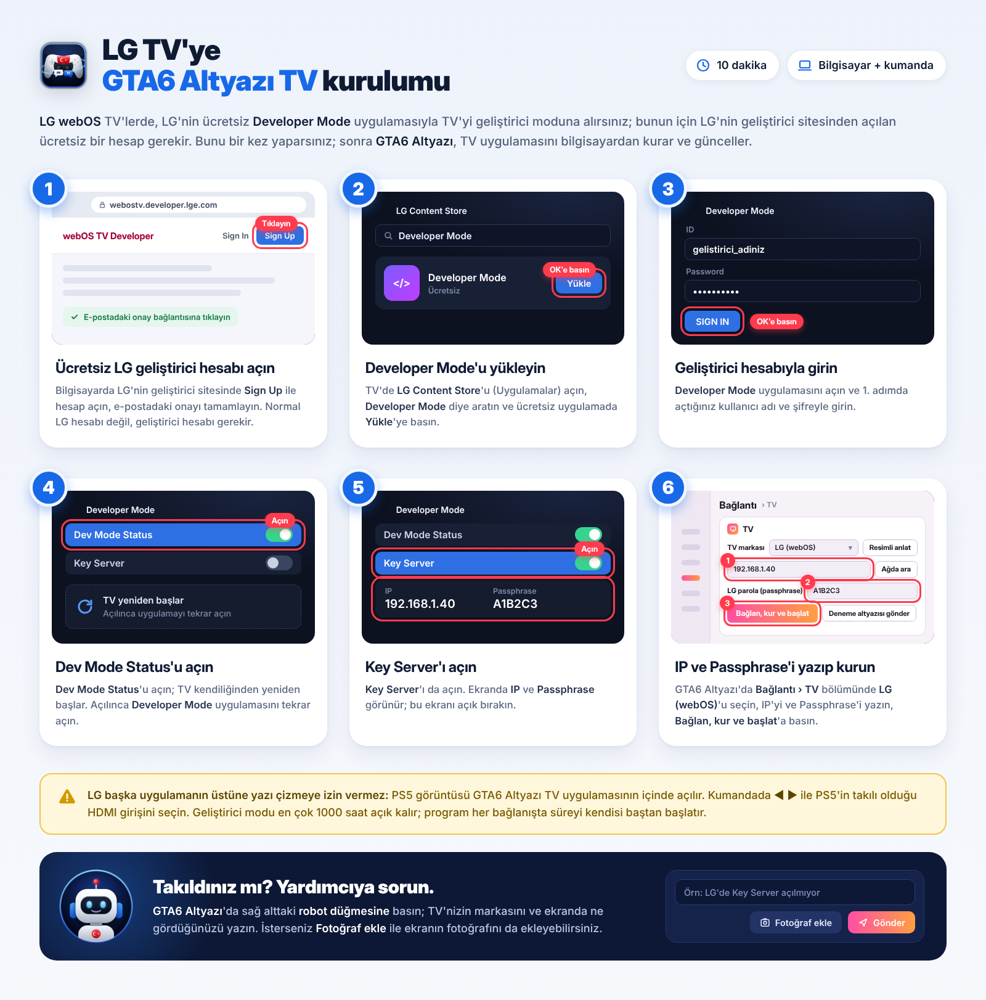

1. Bütün adımlar bir arada: yazdırıp TV'nin yanında tutabilirsin.
2. Bunu bir kez yaparsın; sonra program TV uygulamasını kendisi kurar ve günceller.

</details>

<a name="rehber-samsung"></a>
<details>
<summary><b>📺 TV uygulaması: Samsung (Tizen)</b> · Tizen Studio olmadan, Samsung hesabıyla kurulum.</summary>

#### Adım 1: Uygulamalar sayfasını aç

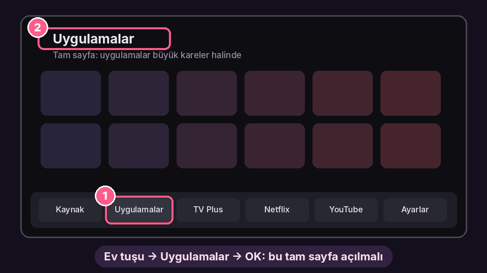

1. Kumandada **ev** tuşuna (evcik simgesi) bas.
2. Alttaki şeritte **Uygulamalar**'a gel ve **OK**'a bas.
3. Uygulamaların büyük kareler halinde dizildiği **tam sayfa** açılmalı.

> Şeritte Uygulamalar'ın üstünde dururken yazarsan çalışmaz; sayfanın içine girmiş olmalısın.

#### Adım 2: 1 2 3 4 5 yaz

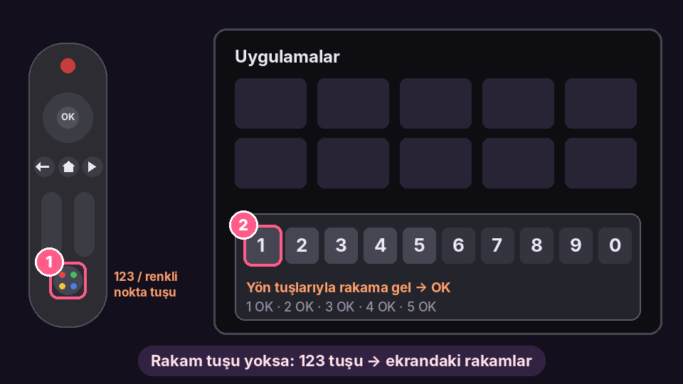

1. Kumandanda rakam tuşları varsa sırayla **1 2 3 4 5**'e bas.
2. İnce akıllı kumandada rakam yok: üstünde **123** ya da **4 renkli nokta** olan tuşa bas, ekranda rakamlar çıkar. Önce bir menü gelirse rakam tuş takımını seç.
3. Yön tuşlarıyla **1**'e gel, **OK**'a bas. Sonra **2** → OK, **3** → OK, **4** → OK, **5** → OK. Arada başka tuşa basma.
4. Doğru yazınca **Developer mode** penceresi açılır.

> Olmazsa Uygulamalar sayfasından çıkıp yeniden gir ve baştan yaz.

#### Adım 3: Kumandayla olmazsa: telefondan yaz

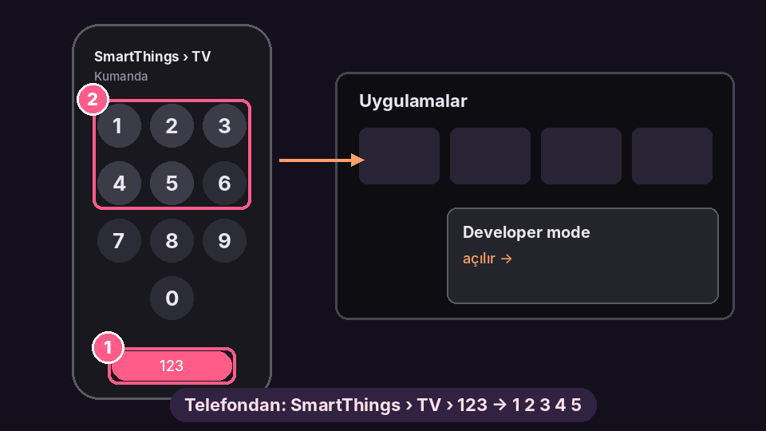

1. Telefona Samsung'un ücretsiz **SmartThings** uygulamasını kur.
2. Telefon ve TV aynı Wi-Fi'de olsun. Uygulamada **+** ile TV'yi ekle, TV'de çıkan onaya **İzin ver** de.
3. SmartThings'te TV'ye dokun; kumanda ekranında **123**'e bas, gerçek rakam tuşları çıkar.
4. TV'de Uygulamalar sayfası açıkken telefondan **1 2 3 4 5**'e bas.

> USB klavye de olur: TV'nin USB girişine tak, Uygulamalar sayfası açıkken üst sıradaki rakamlarla 12345 yaz.

#### Adım 4: Developer mode'u aç

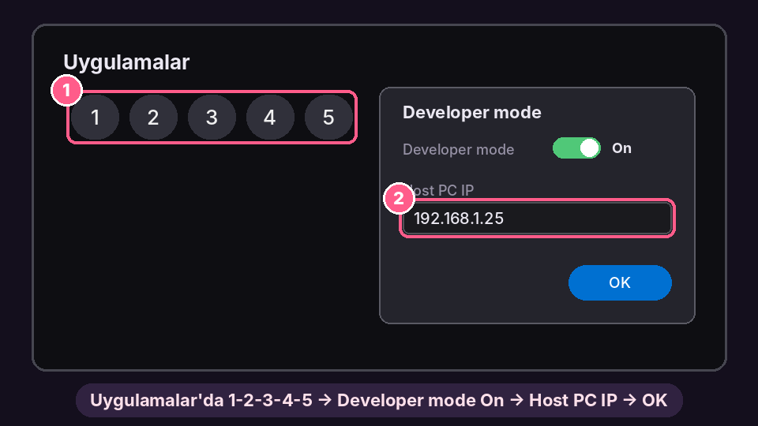

1. Açılan pencerede **Developer mode**'u **On** yap.
2. **Host PC IP**'ye bu bilgisayarın IP'sini yaz (program sihirbazda ve Televizyon sayfasında gösterir), **OK**'a bas.
3. TV'yi kapatıp açmak yetmez: kumandadaki **güç** tuşunu yaklaşık **2 saniye basılı** tut. TV kapanıp kendiliğinden yeniden açılır.
4. Açılınca Uygulamalar sayfasının üstünde genelde **Developer mode** yazar.

#### Adım 5: HDMI'ya kendiliğinden geçişi kapat

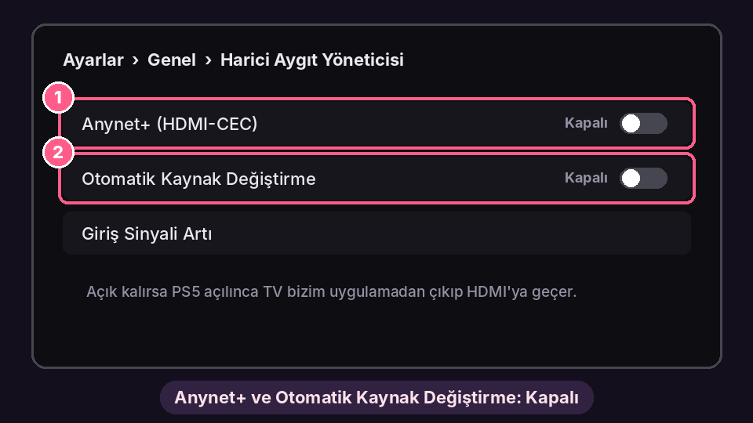

1. TV'de **Ayarlar › Genel › Harici Aygıt Yöneticisi**'ne gir.
2. **Anynet+ (HDMI-CEC)**'yi **Kapalı** yap.
3. Aynı yerde **Otomatik Kaynak Değiştirme** varsa onu da kapat.

> Kapatmazsan PS5 açılınca TV bizim uygulamadan çıkıp doğrudan HDMI'ya geçer ve altyazı görünmez.

#### Adım 6: Programdan kur


1. Programda **Ağda ara**'ya bas ve listeden TV'yi seç. Bulamazsa TV'nin IP'sini elle yaz: TV'de **Ayarlar › Genel › Ağ › Ağ Durumu › IP Ayarları**'nda yazar.
2. **Bağlan, kur ve başlat**'a bas (kurulum sihirbazında: **Bağlan ve kur**).
3. İlk seferde tarayıcıda Samsung hesabı sayfası açılır: gir (hesabın yoksa aynı sayfadan ücretsiz aç). Program uygulamayı bu TV'ye özel imzalatır, kurar ve açar. Sonraki seferlerde giriş gerekmez.

> Tizen Studio gerekmez.

#### Adım 7: HDMI girişini seç

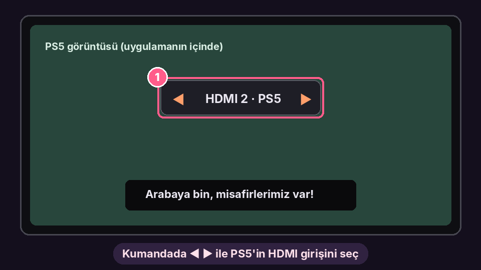

1. Samsung başka uygulamanın üstüne yazı çizmeye izin vermez: PS5 görüntüsü bizim uygulamanın içinde açılır.
2. Kumandada **◀ ▶** ile PS5'in takılı olduğu HDMI girişini seç.
3. Altyazı yeri kaymışsa **Yeşil** tuşla ayar panelini aç (ince kumandada **123** / renkli nokta tuşundan renkli tuşlara geç).

#### Adım 8: Tek resimde özet

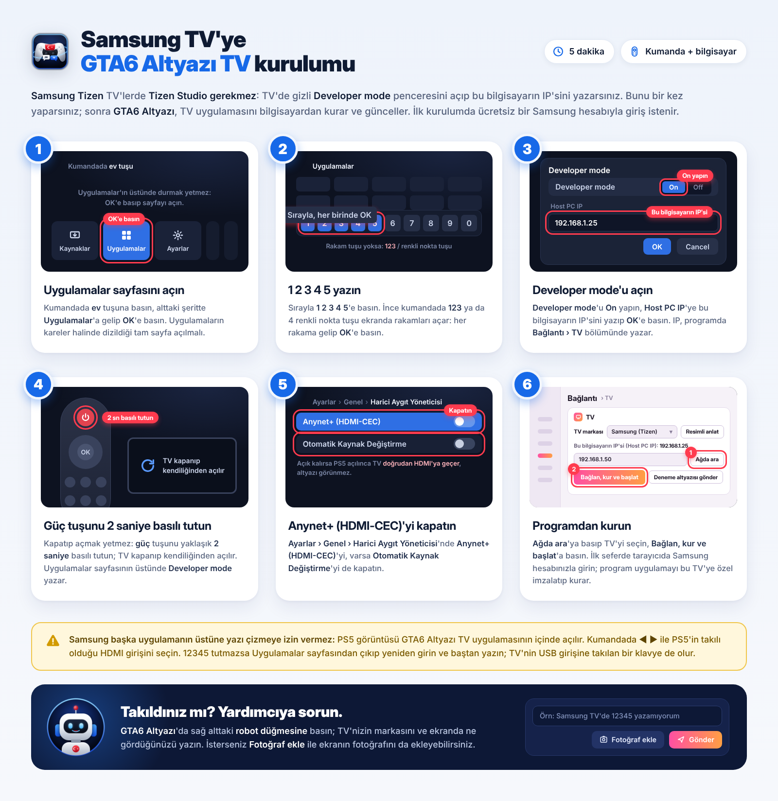

1. Bütün adımlar bir arada: yazdırıp TV'nin yanında tutabilirsin.
2. Bunu bir kez yaparsın; sonra program TV uygulamasını kendisi kurar ve günceller.

</details>

<a name="rehber-discord"></a>
<details>
<summary><b>💬 Discord'da arkadaşlarına yayın</b> · Arkadaşların Türkçe altyazılı izlesin.</summary>

#### Adım 1: Bilgisayardan yayın aç


1. Bilgisayarda ikinci bir Discord hesabıyla sesli kanala gir; mikrofonunu ve sesini kapat.
2. **Ekran Paylaş**'a bas, **Ekranlar** sekmesinden chiaki'nin olduğu monitörü seç, **Yayına Başla**'ya bas.

> Tüm ekranı paylaşmak şart: Türkçe yazı ayrı bir katman olduğu için sadece chiaki penceresini paylaşırsan görünmez.

#### Adım 2: Başka cihazdan konuş


1. Telefondan ya da başka bir bilgisayardan kendi hesabınla aynı kanala gir ve konuş.
2. Kulaklık kullan; yoksa mikrofon TV'nin sesini de alır.

> Bilgisayarın ekranı kilitlenirse okuma durur: ekranı hiç kapanmayacak şekilde ayarla.

</details>

<a name="rehber-obs"></a>
<details>
<summary><b>🎥 OBS ile yayın</b> · Türkçe altyazıyı OBS'de oyunun üstüne koy.</summary>

#### Adım 1: OBS'ye tarayıcı kaynağı ekle

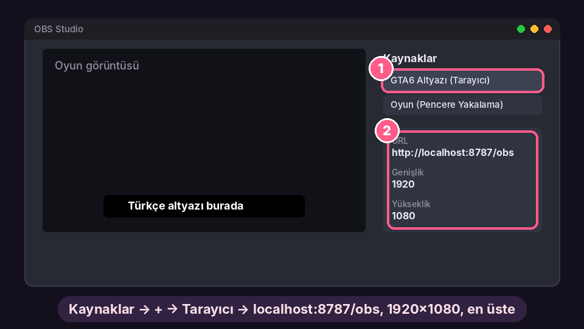

1. OBS'de **Kaynaklar** kutusunda **+**'ya bas, **Tarayıcı**'yı seç.
2. URL: **http://localhost:8787/obs**, genişlik **1920**, yükseklik **1080** yaz.
3. Bu kaynağı oyun görüntüsünün **üstüne** koy.

> Capture kart kullanıyorsan OBS'de Sanal Kamerayı Başlat'a bas ve programda kaynak olarak OBS Virtual Camera'yı seç.

</details>

<a name="rehber-gta6"></a>
<details>
<summary><b>🎯 GTA 6 için okuma alanlarını ayarla</b> · Kutuları gerçek altyazının üstüne oturt (5 dakika).</summary>

#### Adım 1: Oyundan bir kare al


1. Oyunda bir altyazı ekrandayken programda **Okuma alanları** sayfasına gir.
2. **Görüntü al**'a bas.

#### Adım 2: Kutuları yazıların üstüne çek


1. **altyazi** kutusunu alttaki diyalog ve görev yazısının üstüne, **yardim**'ı sol üstteki yardım kutusuna, **bildirim**'i sağ üstteki bildirimlere, **telefon**'u sağda açılan telefon/mesaj ekranına oturt.
2. **Algılanan yazıyı kırmızı göster** açıkken kırmızı noktalar yazının üstünde toplanıyorsa ayar doğrudur.
3. **Kaydet**'e bas.

</details>

<a name="rehber-ucretsiz"></a>
<details>
<summary><b>🆓 Ücretsiz çeviri (Gemini, DeepL, Ollama)</b> · Claude şart değil: ücretsiz yapay zekâ seçenekleri ve arkadaşlarla paylaşım.</summary>

#### Adım 1: Yerel model zaten ücretsiz

1. Hiçbir şey yapmasan da ekran kartındaki yerel model çevirir: internetsiz, ücretsiz ve anında.
2. Daha doğal Türkçe için üstüne aşağıdaki ücretsiz yapay zekâlardan birini ekleyebilirsin.

> Herkes kendi anahtarını kullanır; kimse başkasının çevirisini ödemez. Claude şart değil.

#### Adım 2: Google Gemini (ücretsiz anahtar)

1. **Anahtar al**'a bas, Google hesabınla gir ve **Create API key**'e bas.
2. Programda **Çeviri** sayfasında kalite katmanını **Google Gemini** seç, anahtarı yapıştır, **Kaydet**'e bas.

🔗 [Anahtar al](https://aistudio.google.com/apikey)

> Ücretsiz kotası oyun oynamak için genelde yeter.

#### Adım 3: DeepL (ücretsiz plan)

1. DeepL'in sayfasında **DeepL API Free** planına üye ol (kart bilgisi ister, ücret almaz).
2. Hesap sayfasındaki anahtarı kopyala (sonu **:fx** ile biter).
3. Programda kalite katmanını **DeepL** seç, anahtarı yapıştır, **Kaydet**'e bas.

🔗 [DeepL API sayfası](https://www.deepl.com/pro-api)

> Ayda 500 bin karaktere kadar ücretsiz.

#### Adım 4: Yerel yapay zekâ (Ollama, tamamen ücretsiz)

1. **Ollama**'yı indirip kur.
2. Komut satırında (PowerShell) **ollama pull qwen2.5:7b** yaz, modelin inmesini bekle.
3. Programda kalite katmanını **Yerel yapay zekâ** seç; adres **http://localhost:11434/v1**, model **qwen2.5:7b** olarak gelir. **Kaydet**'e bas.

🔗 [Ollama'yı indir](https://ollama.com/download)

> Anahtar, kota ve ücret yok; altyazı bilgisayardan çıkmaz. Ekran kartı varsa bir satır 1-2 saniyede gelir.

#### Adım 5: Arkadaşlarınla çevirileri paylaş

1. Biri Claude ya da Gemini ile oynadıkça çeviriler önbelleğe birikir.
2. **Çeviri** sayfasında **Önbelleği paket olarak kaydet** ile dosya yapıp arkadaşlarına at.
3. Onlar **Paket ekle** ile yükler; o satırlar onlarda da aynı kalitede, anında ve ücretsiz çıkar.

</details>

<a name="rehber-paketler"></a>
<details>
<summary><b>📦 Hazır çeviri paketleri</b> · GTA 6, GTA V, RDR2 ve diğer oyunların paketleri; kendi paketini paylaş.</summary>

#### Adım 1: Hazır paket indir

1. **Çeviri** sayfasında **Önbellek ve çeviri paketleri** kartına in.
2. Listeden oyunu seç (**GTA 6**, GTA V, RDR2...) ve **Hazır paketi indir**'e bas.

> GTA 6 dahil paketler kurulumla birlikte gelir; pakette olan satırlar anında ve ücretsiz çıkar. Paketler bu projenin GitHub sayfasında her 6 saatte bir güncellenir (GTA 6 paketi oyuncular oynadıkça büyür); ara sıra Listeyi yenile'ye basıp yeniden indirebilirsin.

#### Adım 2: Kendi paketini paylaş

1. **Önbelleği paket olarak kaydet** ile oynadıkça biriken çevirileri dosya yap.
2. Arkadaşların bu dosyayı **Paket ekle** ile yükler.

</details>

<a name="rehber-guncelleme"></a>
<details>
<summary><b>🔄 Güncellemeler</b> · Paketler sessizce, uygulama tek tıkla güncellenir; yeniden kurmak gerekmez.</summary>

#### Adım 1: Paketler kendiliğinden güncellenir

1. Program her açılışta GitHub'daki hazır paketlere bakar.
2. Bilgisayarındaki bir paketin (ör. GTA 6) yenisi varsa sessizce indirir; köşede "Hazır paket güncellendi" yazar.

> Kurulumu yeniden yapmana gerek yok. Ayarlar › Güncellemeler'den kapatabilirsin.

#### Adım 2: Uygulama tek tıkla güncellenir

1. Yeni sürüm çıkınca ana ekranın en üstünde **Yeni sürüm hazır** kartı çıkar.
2. **Güncelle**'ye bas: kurulum dosyası iner, kendiliğinden kurulur ve program yeni sürümle yeniden açılır.
3. Ayarların, anahtarların ve paketlerin korunur.

> Neyin değiştiğini GitHub'daki sürüm notlarında (CHANGELOG) görebilirsin.

</details>

<a name="rehber-sorunlar"></a>
<details>
<summary><b>🧰 Sorun giderme</b> · TV bağlanmıyor, altyazı çıkmıyor, yazı kayık...</summary>

#### Adım 1: TV bilgisayara bağlanamıyor

1. **Televizyon** sayfasında **Bağlantı izni › İzin ver**'e bas (Windows bir kez "Evet" ister).
2. Bilgisayarın ağı **Ortak** görünüyorsa Windows Ayarları › Ağ ve İnternet'te **Özel** yap.
3. TV ve bilgisayar aynı modeme mi bağlı, bak; menzil arttırıcı bazen cihazları ayırır.

#### Adım 2: Altyazı hiç çıkmıyor

1. Oyunun kendi ayarlarında **altyazılar açık** mı, bak.
2. chiaki penceresi **simge durumunda** olmasın.
3. **Okuma alanları › Görüntü al** ile kutuların yazının üstünde olduğunu kontrol et.

#### Adım 3: Türkçe kayık ya da yanlış yerde

1. chiaki'yi tam ekran (**F11**) yap ya da pencereyi büyüt.
2. **Okuma alanları**'nda kutuları yeniden oturt.
3. TV'de kumandanın **Yeşil** tuşu bilgi panelini açar; bağlantı ve HDMI orada görünür.

#### Adım 4: chiaki PS5'e bağlanmıyor

1. PS5'te **Uzaktan Oynatma** açık mı, bak.
2. Kayıt sırasında PIN hatası verdiyse kodun süresi dolmuştur; PS5'te **Cihazı Bağla**'ya yeniden bas.
3. chiaki'ye girdiğin hesapla PS5'te oturum açtığından emin ol.

#### Adım 5: Çeviri yavaş ya da Claude çalışmıyor

1. **Çeviri** sayfasındaki **Dene** kutusuna bir cümle yazıp **Çevir**'e bas; süreyi ve motoru gösterir.
2. Claude anahtarını ve Anthropic hesabındaki krediyi kontrol et.
3. Anahtar yoksa da program yerel modelle çalışmaya devam eder.

</details>

<!-- REHBER:BITIS -->

### Desteklenen TV'ler

| TV | Nasıl çalışır | TV'de yapılacak |
|---|---|---|
| **Google TV / Android TV** | Oyunun üstüne katman ya da HDMI uygulamanın içinde | Geliştirici seçenekleri › USB / Kablosuz hata ayıklama |
| **LG (webOS)** | HDMI uygulamanın içinde, altyazı üstünde | Developer Mode uygulaması |
| **Samsung (Tizen)** | HDMI uygulamanın içinde, altyazı üstünde | Developer mode (1-2-3-4-5) |

TV kumandası: **Yeşil** bilgi paneli · **◀ ▶** ya da **1-4** HDMI girişi · **0** konsolu yeniden ara · **Kırmızı** deneme altyazısı.

## ⌨️ Kısayollar

| Tuş | Ne yapar |
|---|---|
| **Ctrl+Shift+9** | Ekrandaki her şeyi çevirir (menü, harita, telefon...). Tekrar basınca ya da 20 saniye sonra kapanır |
| **Ctrl+Shift+0** | Duraklatır / devam ettirir |

TV'den oynarken aynı düğmeler telefon kumandasında da var; ana ekrandaki QR kodunu okutman yeterli.


## ❓ Sık sorulanlar

<details>
<summary><b>Capture kart almam gerekiyor mu?</b></summary>

Hayır. Kasa görüntüyü chiaki-ng ile ağ üzerinden alır. Capture kart istersen de destekleniyor (Ayarlar › Görüntü kaynağı).

</details>

<details>
<summary><b>İnternet olmadan çalışır mı?</b></summary>

Evet. Yerel model, OCR ve paketler internetsiz çalışır. Claude ve "ekranı çevir" özelliği internet ister.

</details>

<details>
<summary><b>Para ödemem gerekiyor mu? Claude şart mı?</b></summary>

Hayır. Yerel model hep ücretsiz çalışır. Daha doğal Türkçe için ücretsiz seçenekler var: Google Gemini (ücretsiz anahtar), DeepL Free (ayda 500 bin karakter) ya da bilgisayarında çalışan Ollama (anahtar ve kota yok). Claude en iyi kaliteyi verir ama ücretlidir: yalnızca daha önce görülmemiş satırlar gider, önbellekte ya da pakette olanlar ücretsizdir. Herkes kendi anahtarını kullanır; kimse başkasının çevirisini ödemez. Ayrıntılar: [Ücretsiz çeviri rehberi](#rehber-ucretsiz).

</details>

<details>
<summary><b>Görev yazısı ile diyalog üst üste binince ne olur?</b></summary>

Satırlar arasındaki boşluğa bakılarak ikisi ayrı yazı sayılır, ayrı çevrilir ve her biri kendi yerine basılır. İki satıra bölünmüş tek bir cümle ise ayrılmaz.

</details>

<details>
<summary><b>OCR bir harfi yanlış okursa?</b></summary>

Daha önce çevrilmiş satır önbellekten yine bulunur; yalnızca OCR'ın gerçekten karıştırdığı harf farklarına (l/1/I, 0/O gibi) izin verilir. "Go to the car" ile "Go to the bar" ya da "$500" ile "$5000" gibi anlamı farklı cümleler asla karıştırılmaz.

</details>

<details>
<summary><b>Bu proje Rockstar ya da Sony ile bağlantılı mı?</b></summary>

Hayır. Bağımsız, ücretsiz ve açık kaynaklı bir hayran projesidir.

</details>

## 🛠️ Geliştirme

<details>
<summary>Kaynak koddan çalıştırma, klasörler, derleme</summary>

```bash
pip install -r requirements.txt pytest pillow
python -m altyazi              # arayüz
python -m altyazi calistir     # arayüzsüz
python -m pytest tests
```

| Klasör | İçerik |
|---|---|
| `altyazi/` | Çekirdek: yakalama, tespit, OCR, çeviri, hat, sunucu, TV kurulumu |
| `altyazi/ui/` | Arayüz (PySide6) |
| `altyazi/samsung/` | Tizen Studio'suz Samsung kurulumu |
| `tv-android/` | Android TV uygulaması |
| `tv-web/` | LG (webOS) ve Samsung (Tizen) TV uygulaması |
| `packaging/` | PyInstaller tarifi, Inno Setup kurulum betiği, görseller |
| `tests/` | Testler. `synth.py` GTA tarzı sahte kareler üretir |
| `tools/` | Model indirme, TV paketi hazırlama, README görselleri (`readme_gorsel.py`) |

- **Kurulum dosyasını kendin derlemek:** `derle.bat`'a çift tıkla (Python 3.12 ve Inno Setup gerekir). Sonuç: `dist\GTA6Altyazi-Setup.exe`.
- **Otomatik derleme:** TV uygulamaları `tv-android/` ya da `tv-web/` değişince GitHub Actions ile derlenir. Windows kurulum dosyası commit mesajında `[exe]` geçince derlenip Releases'e konur.
- **README görselleri:** `QT_QPA_PLATFORM=offscreen python tools/readme_gorsel.py`

</details>

## 📜 Lisans ve teşekkür

GTA6 Altyazı, [GNU AGPL-3.0](LICENSE) ile lisanslanmıştır. Sinan Yorulmaz'ın [CouchSubs](https://github.com/yorulmazsinan/couchsubs) projesinden (ve ondan türeyen [GameTranslator](https://gitlab.com/sefflex/GameTranslator)'dan) alınan kodları içerir; ayrıntılar [NOTICE](NOTICE) dosyasında. TV uygulamaları CouchSubs'tan gelir. CouchSubs ve GameTranslator geliştiricilerine teşekkürler.

<sub>GTA6 Altyazı; Rockstar Games, Take-Two Interactive ya da Sony Interactive Entertainment ile bağlantılı değildir. "Grand Theft Auto" Take-Two'nun, "PlayStation" ve "PS5" Sony Interactive Entertainment Inc.'in ticari markalarıdır.</sub>
